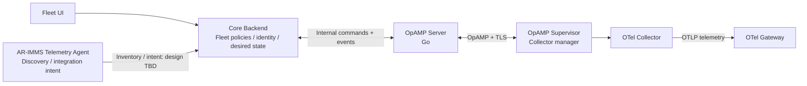

# AR-IMMS OpAMP Server

> Go-based OpAMP protocol control plane for managing a fleet of data collection agents. **Planning / bootstrap documentation** — implementation status must be verified in code.

## At a glance

| Question | Answer |
|---|---|
| Why? | Connect managed agents, receive status, deliver remote configuration and report outcomes. |
| Who owns fleet policy? | AR-IMMS Core (NestJS). |
| Who owns OpAMP sessions? | This service. |
| Who manages Collector processes? | Official OpAMP Supervisor (on managed hosts). |
| Who discovers services / integrations? | AR-IMMS Telemetry Agent. |
| Does this service store desired configuration? | **No**: Core is authoritative; a transient delivery cache is permitted only with reconciliation rules. |
| Current first target | Standalone authenticated OpAMP server + fake clients, then Supervisor interoperability. |

**Diagram caveat:** the Agent-to-Core discovery interface and Core-to-Server contract are planned interfaces, not already implemented.

## Read this, not everything

1. [System overview](docs/local/architecture/system-overview.md) — diagram, ownership and boundaries.
2. [Main flows](docs/local/architecture/flows.md) — connection, status, remote config, recovery.
3. [Clean Architecture / code structure](docs/local/architecture/clean-architecture.md) — where new code belongs.
4. [Coding policy](docs/local/development/CODING_POLICY.md) — rules for human and AI coding.
5. [Quality gates](docs/local/development/QUALITY_GATES.md) — what must pass before merge/release.

## First implementation target

- Start / stop cleanly and expose a configurable OpAMP endpoint.
- Authenticate clients **before** enabling externally reachable access.
- Track active authenticated sessions and handle close/reconnect without stale ownership.
- Accept agent descriptions/status and emit normalized events.
- Deliver desired remote configuration to capable clients and distinguish **sent** from **applied**.
- Test independently with fake OpAMP clients, then an official Supervisor.

Deferred: UI, fleet rollouts, package upgrades, generalized multi-tenant storage, production deployment.

## Source of truth & references

- [OpAMP protocol specification](https://opentelemetry.io/docs/specs/opamp/)
- [Official Go SDK](https://github.com/open-telemetry/opamp-go)
- [Collector Supervisor implementation](https://github.com/open-telemetry/opentelemetry-collector-contrib/tree/main/cmd/opampsupervisor)
- Cross-repository decisions belong in **AR-IMMS `shared-docs`**. The `docs/shared` directory here contains integration references/proposals, not an independently authoritative duplicate.
