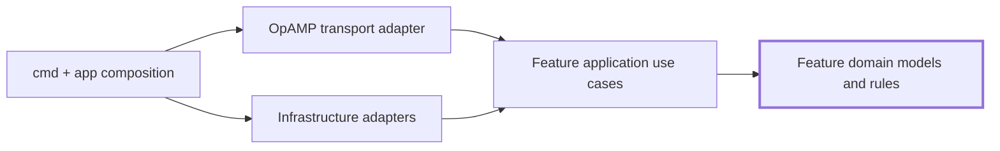

# Clean Architecture and code organization

**Architecture choice:** Clean Architecture with cohesive feature modules, not a giant shared `internal/` bucket. Keep the domain simple. Introduce abstractions only across real boundaries.

## Proposed repository layout

```text
fleet-manager/
├── cmd/
│   └── fleet-manager/
│       └── main.go                   # Composition root only
├── internal/
│   ├── app/
│   │   ├── bootstrap.go              # Wire dependencies / lifecycle
│   │   └── config.go                 # Validated runtime settings
│   ├── identity/
│   │   ├── domain/                    # Authenticated principal, session rules
│   │   ├── application/               # Connect, disconnect, session ownership
│   │   └── infrastructure/            # In-memory session registry
│   ├── observervations/
│   │   ├── domain/                    # Normalized status / capability meanings
│   │   ├── application/               # Receive, validate, forward
│   │   └── infrastructure/            # Core event adapter (later)
│   ├── configuration/
│   │   ├── domain/                    # Delivery state, hash correlation
│   │   ├── application/               # Request delivery, reconcile reports
│   │   └── infrastructure/            # In-memory delivery state (initial)
│   ├── .../                           # Context boundaries
│   │   ├── .../                       # Clean architecture folder like domain, application, etc,..
│   └── transport/
│       └── opamp/                    # Upstream SDK, protobuf, callbacks, mapping
├── tests/
│   ├── integration/                  # Real OpAMP client/server tests
│   └── testkit/                      # Fake clients, clocks, identity adapters
├── docs/
│   ├── local/                        # Service architecture/policy/ADR
│   └── shared/                       # Cross-repo reference/proposal
├── .github/workflows/
├── AGENTS.md
└── README.md
```

Create these directories **as implementation requires**, not all as empty placeholders. `infrastructure/` represents replaceable adapters; domain and use cases must not depend on it.
**NOTE**: It is not neccessary to follow exactly the repository structure, this is a reference example about how it should organization

## Dependency rule



**Allowed:** adapters import use-case ports and implement them.
**Forbidden:** domain/application importing `opamp-go`, protobuf, `net/http`, database clients, or infrastructure packages.

## Where should I put this code?

| Need | Location | Reason |
|---|---|---|
| Parse `AgentToServer` protobuf | `transport/opamp` | Protocol-specific translation |
| Authenticate connection against Core | `agentconnection/application` port + adapter | Identity decision outside protocol details |
| Track active sessions | `agentconnection` | One owner for connection lifecycle |
| Interpret reported health | `statusreporting` | Stable meaning independent of protobuf |
| Deliver revision/hash to client | `configurationdelivery` | Delivery logic separate from business desired state |
| Open listener, shutdown | `app` + `cmd` | Composition/runtime |
| Audit/desired state/asset mapping | **Core**, not this repo | Business source of truth |
| Collector process start/restart | **Supervisor**, not this repo | Runtime ownership |

## Interfaces: minimal examples (illustrative, not locked API)

```go
// Application-layer port: implementation may call Core or a test double.
type IdentityVerifier interface {
    VerifyConnection(ctx context.Context, credential string) (Principal, error)
}

// Application-layer port: desired config is selected by Core.
type DesiredConfigurationReader interface {
    GetDesired(ctx context.Context, installationID string) (DesiredConfig, error)
}
```

Do not directly pass raw credential strings around or log them in production code; the example illustrates direction only. Prefer request structs and secret-safe types when implemented.

## Extensibility without abstraction inflation

- Add a new OpAMP capability by extending protocol mappings and a **single relevant use case**, not cloning the server.
- Add another Core transport by implementing a port, not changing domain rules.
- Add another session store only if multi-instance HA is actually required; define ownership semantics first.
- Add support for a non-Collector OpAMP client through negotiated capabilities, not a Collector-specific assumption in protocol/domain.

## No duplication rules

- Do not recreate Core's Agent Installation table in Go.
- Do not fork upstream Supervisor as a prerequisite.
- Do not create a generic `common`, `utils`, or `interfaces` package without a concrete shared responsibility.
- Avoid import cycles and feature-to-feature infrastructure imports.
