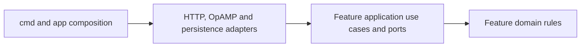

# Clean Architecture and code organization

**Architecture choice:** cohesive Fleet features with inward dependencies. The [shared Fleet contracts](../../shared/contracts/fleet-management/README.md) define ownership; this page guides code placement, not wire approval. Create packages as implementation requires.

## Dependency rule

Domain and application packages must not import OpAMP protobufs, `net/http`, framework or storage drivers. Adapters translate wire/storage representations into feature types and implement application ports. `cmd` and `app` wire dependencies and lifecycle. Avoid a generic shared package until a real shared responsibility exists.

## Feature boundaries

| Concern | Suggested owner | Boundary |
|---|---|---|
| Invitations, installation, credential lifecycle | `identity` / `enrollment` | Core-authorized invitation and Agent exchange through HTTPS adapters; durable recovery and revocation |
| Authenticated session ownership | `identity` / `sessions` | OpAMP adapter supplies verified identity and UID evidence; one owner handles reconnect races |
| Typed monitoring intent and desired revisions | `configuration` | Core management adapter; Fleet domain owns revision/CAS and policy admission |
| Rendering, publication and reported outcomes | `configuration` | Durable hash/revision mapping before native OpAMP send; distinguish observed evidence |
| Agent inventory and health evidence | `observations` | Agent HTTPS adapter; scope, completeness, freshness and provenance rules |
| Fleet execution audit | `audit` or cohesive feature records | Correlate Core operation IDs without copying business audit or secrets |
| Native OpAMP protocol mapping | `transport/opamp` | Protobufs, capability checks and callback translation only |
| Runtime wiring and settings | `app`, `cmd` | Listener, TLS, storage and shutdown lifecycle |

Package names are suggestions, not a required skeleton. Current code has `internal/app`, `internal/identity`, and `internal/transport/opamp`; no other feature package is implemented yet.

## Persistence and external integrations

Fleet needs durable authority for credentials, desired revisions, publication mappings, observations and execution history. Define repository ports from use-case needs; choose database layout and atomicity based on actual deployment. Treat events as wakeups, with persisted state supporting reconciliation after missed events or restart. Do not assume standalone MongoDB supports multi-document transactions or change streams.

Core keeps IAM, Node/Asset and business audit in its own store. Agent keeps local operational history and protected secrets. Official Supervisor owns Collector execution. Extend Fleet through the relevant use case and adapter instead of duplicating these responsibilities.

## Contract gate

Accepted C01–C04 ownership may shape modules now. Proposed endpoint fields, auth scopes, UID binding, remote config composition and migration must be reviewed by their named owners before code depends on them. Capture Fleet-local choices in [local ADRs](../decisions/README.md); cross-system decisions belong in shared contracts.
