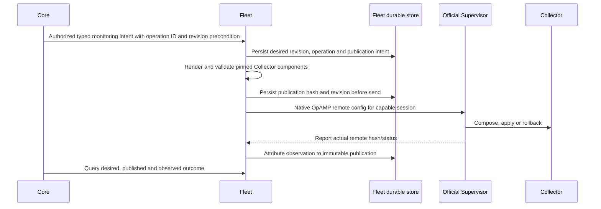

# Fleet Management target flows

**Status:** target behavior from the [shared Fleet contracts](../../shared/contracts/fleet-management/README.md); none of these end-to-end flows is implemented in this repository. Diagrams show ownership obligations, not approved wire paths or exact OpAMP frame order.

## 1. Preapproved enrollment and authenticated session (C01, C04)

```mermaid
sequenceDiagram
  actor Operator
  participant Core
  participant Fleet
  participant Agent as Telemetry Agent
  participant Sup as Official Supervisor
  Operator->>Core: Authorize Node invitation
  Core->>Fleet: Trusted invitation request
  Fleet->>Fleet: Persist bounded invitation
  Agent->>Fleet: Exchange invitation with stable agent_id and attempt proof
  Fleet->>Fleet: Atomically bind installation and persist recoverable result
  Fleet-->>Agent: Credential and Supervisor endpoint
  Agent->>Sup: Provision protected credential and fallback
  Sup->>Fleet: Authenticated native OpAMP connection
  Fleet->>Fleet: Bind instance_uid to verified installation; claim session
```

Same-attempt lost-response recovery must not issue a second credential. Replay, wrong binding, revoked credentials and ambiguous UID conflicts fail closed. Exact proofs, auth scopes and UID mapping remain OPEN.

## 2. Desired configuration to observed outcome (C02, C04)



CAS/idempotency, already-connected update, offline reconciliation, old/unknown hash, rollback and OTLP delivery require separate tests. Desired and published do not imply applied; APPLIED does not imply Collector readiness or OTLP delivery. Intent schema, hash canonicalization, composition and retry policy remain OPEN.

## 3. Agent observations and freshness (C03)

Agent reports authenticated host identity, resource inventory, dependency status and local health over HTTPS. Fleet validates principal scope, schema, provenance and bounds, then durably stores scoped observations. `COMPLETE` inventory may establish absence only within its provider/scope and only when newer; `PARTIAL` only upserts; `FAILED` does not become an empty complete snapshot. Supervisor OpAMP reports and OTLP evidence remain separate sources. Stale or conflicting evidence becomes UNKNOWN, not confirmed Core topology.

## 4. Reconnect, revocation and migration

After disconnect or Fleet restart, authenticate again, resolve UID/session ownership, read persisted latest desired state and publication history, and reconcile with actual reported hash. Unknown outcomes stay UNKNOWN until evidence arrives. Commit revocation before closing sessions; reject reconnect and prevent later publication to the revoked identity. Revocation alone does not assert that the Collector stopped.

Maintain separate legacy Agent-managed, current Core-backed Supervisor-managed, and target Fleet-backed Supervisor-managed states. Migration and rollback require explicit approved contracts and real Windows/Linux interoperability evidence; a mock Fleet pass does not prove production behavior.
