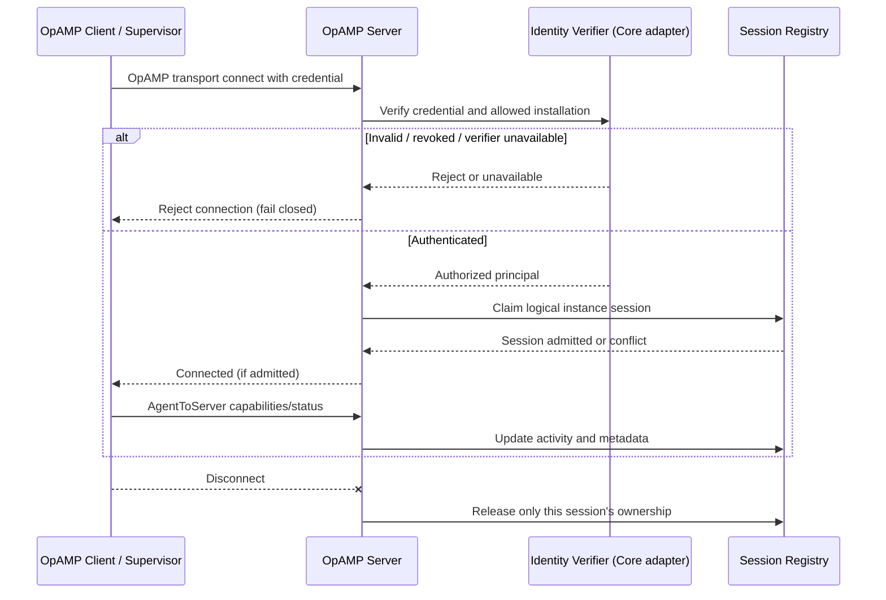
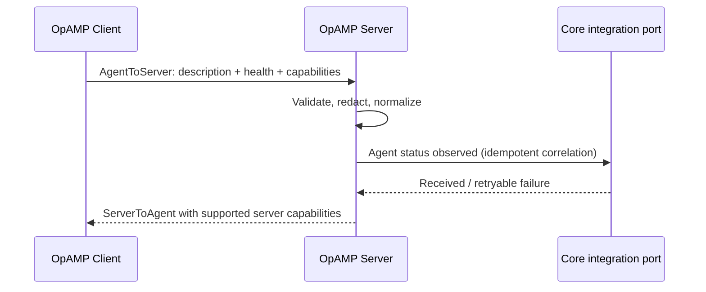
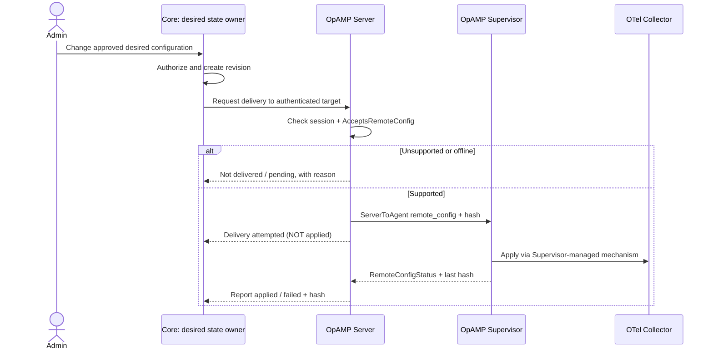
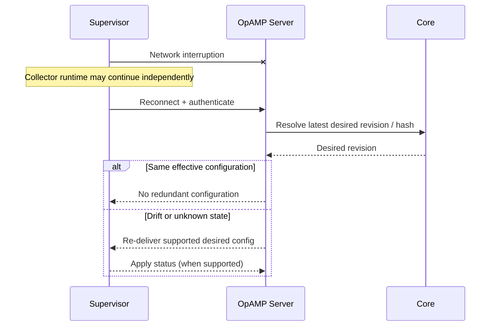

# Essential end-to-end flows

**Goal:** explain what happens, who is responsible and what counts as success. All diagrams are **target behavior**, not an assertion that code exists.

## 1. Connection, authentication and session ownership

**Acceptance:** revoked credentials rejected; stale close cannot evict a newer reconnect; sessions never keyed solely by unverified UID. Local harness may substitute a deterministic fake identity verifier, but cannot present itself as production auth.

## 2. Reporting health, descriptions and capabilities

**Acceptance:** capability flags are not misrepresented; known fields survive normalization; unknown extensions are safe; duplicate messages do not invent new installations. `online` means a valid live session; healthy means the reported health state, and is not equivalent to a good telemetry exporter.

## 3. Remote configuration and outcome tracking

**Acceptance:** statuses are correlated to exact config hash/revision. Sending is not applying. Do not guess success if client is offline, omits status, or reports an unexpected hash.

## 4. Reconnection and desired-state reconciliation

**Acceptance:** new session wins according to explicit policy, old disconnect cannot delete it; no regression to stale desired revision; retries are bounded and observable.

## 5. Negative paths to test

| Situation | Expected outcome |
|---|---|
| Revoked credential | Reject; no session |
| Duplicate UID from different authenticated principals | Reject or isolate per reviewed identity policy |
| Client lacks remote-config capability | Do not send; report unsupported |
| Unexpected / old config hash | Do not mark latest revision applied |
| Status event delivery to Core fails | Retry/buffer per bounded design; record failure, do not claim delivered |
| Server restarts | Agents reconnect and reconcile with Core source of truth |
| Malformed/oversized OpAMP message | Reject safely, no crash or sensitive log dump |
