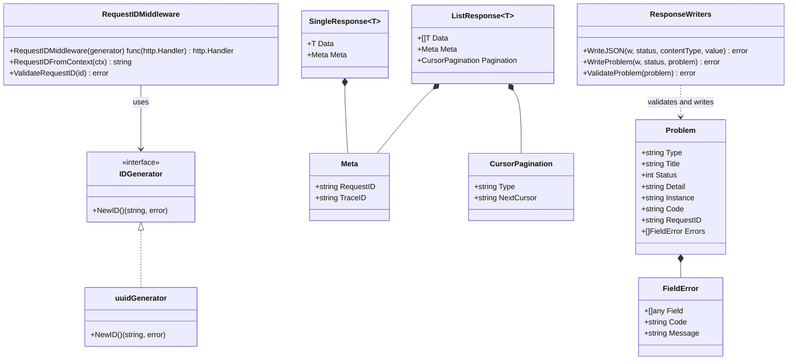

# HTTP response baseline

**Status:** implemented reusable platform primitives. The shared Fleet REST baseline remains proposed; endpoint contracts decide where to adopt it and which errors they support. This package does not add endpoints or change health or OpAMP behavior.

## Where it lives

`internal/platform/httpapi` contains transport-neutral HTTP response helpers. Delivery adapters can use these types and writers. The package is not currently mounted on the health routes.

## Request ID flow

`RequestIDMiddleware` accepts a single caller-provided `X-Request-Id` when it is 1–128 characters and contains no control characters. Otherwise it asks an `IDGenerator` for an ID. A nil generator uses `google/uuid` random generation. The selected ID is placed in request context and returned in the response header. `RequestIDFromContext` lets downstream handlers read it. If generation fails or returns an invalid value, middleware sends a generic 500 and does not expose the generator error.

An existing shared context ID takes precedence over the header; an incompatible inherited ID fails with a generic 500. Nested middleware reuses the selected ID. Context access now lives in `internal/shared/correlation`; the HTTP getter forwards to it. See [request correlation](request-correlation.md) for HTTP, gRPC, and message adapter policies.

Caller ID format is deliberately not constrained beyond safe header characters and the baseline length. UUID v4 is only the current default generator, not an approved wire format.

## Response types and writing

- `SingleResponse[T]` wraps one `data` value and `Meta`.
- `ListResponse[T]` wraps a `data` slice and optional cursor pagination.
- `CursorPagination.NextCursor` is always serialized; a nil pointer becomes JSON `null`.
- `Problem` carries the proposed Problem Details fields and optional field errors. Endpoint adapters supply its title, detail, instance, code, and request ID.
- `FieldError.Field` is an ordered path of property names and nonnegative integer indexes. Error messages must not include submitted secrets or values.

`WriteJSON` marshals the full value before setting `Content-Type` or writing a status. Encoding failure therefore cannot leave a partial JSON response or commit success headers. `WriteProblem` first validates the DTO and requires its body status to equal the HTTP status; successful Problems use `application/problem+json`.

The helpers validate required request IDs, trace ID shape, Problem status, the draft error-code pattern, URI references, validation error codes, and field path segments. They do not map application errors to HTTP errors or decide business error codes.

## Class diagram

## Decisions left open

- Adopt the envelope and Problem DTO per endpoint contract; neither is a global business API decision.
- Choose the request ID format, `instance` construction, and concrete error-code set in the owning API contract.
- Decide where to mount request-ID middleware when REST endpoints are added. Health and OpAMP remain outside this change.
