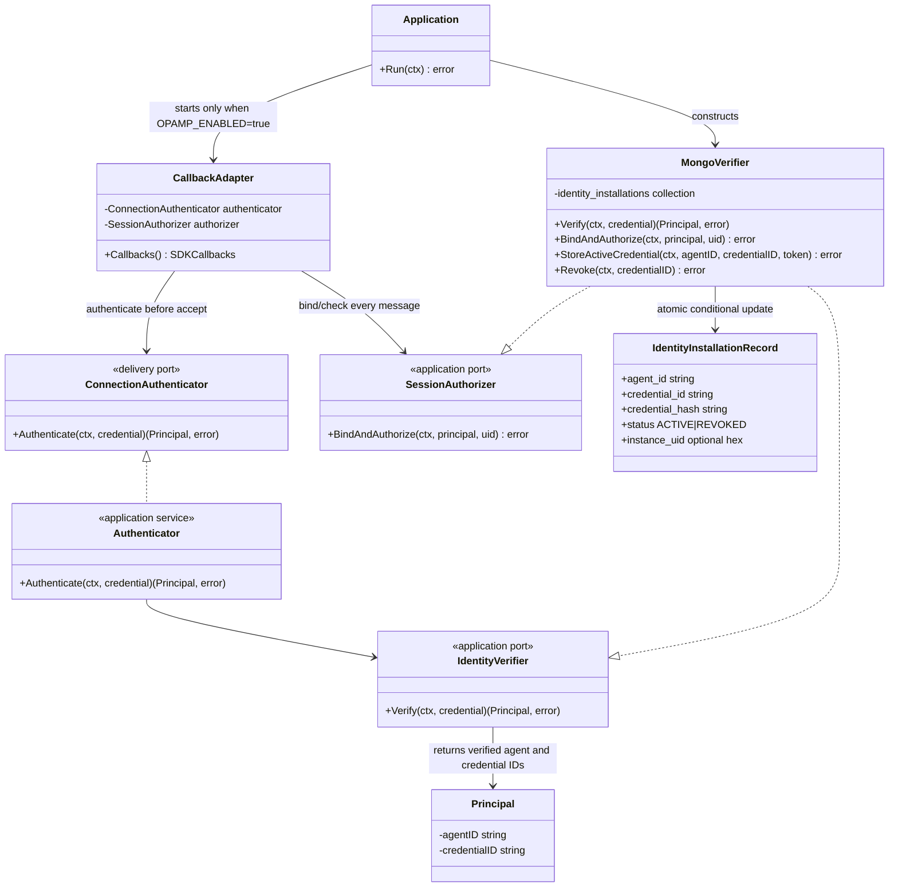

# Identity verification and Supervisor UID binding

**Implementation status:** Mongo-backed verification, guarded UID binding, application composition, and identity schema/index startup are implemented. OpAMP starts only when `OPAMP_ENABLED=true` and defaults to disabled. The exact credential wire contract remains unapproved. Hosted Ubuntu/Windows UID continuity and Mongo binding checks passed; the expanded migration and application/Mongo/Supervisor integration suites also passed locally. The updated workflow awaits its hosted run.

## Ownership and identifiers

- **ACCEPTED by C01 Enrollment, Installation Identity & Credential Lifecycle:** `agent_id` reuses the Agent's persisted installation UUID. Fleet verifies credentials and owns revocation/session authorization. Host evidence does not authenticate an installation.
- **ACCEPTED by C04 OpAMP Integration Profile:** authenticate before binding; Supervisor `instance_uid` is a protocol identifier, not proof of identity. Do not silently remap a conflicting UID.
- `agent_id` and Supervisor `instance_uid` remain separate values. The current Mongo adapter stores the UID as the hex encoding of the exact 16 OpAMP bytes; it does not derive one identifier from the other.
- **Locally verified on Windows:** official Supervisor v0.160.0 retained the same UID after restart with the same state directory and produced a different UID with a fresh directory. Ubuntu CI and behavior across upgrade, reinstall, and other state-loss cases remain unverified. The [pinned Supervisor v0.160.0 README](https://github.com/open-telemetry/opentelemetry-collector-contrib/blob/cmd/opampsupervisor/v0.160.0/cmd/opampsupervisor/README.md) documents its persistent storage directory.

## Design and request flow

The credential token is hashed with SHA-256 before storage. This implementation assumes a high-entropy token of at least 32 bytes; the enrollment flow must generate it randomly and return it only to its authorized recipient. Raw tokens are not written to MongoDB or logs. Startup reconciles unique indexes for credential hash, credential ID, `agent_id`, and string-valued Supervisor UID. Expiration is not represented or checked yet: an active record remains valid until explicitly revoked. This is a deliberate limit while C01 expiry/rotation rules are OPEN and a reason production deployments should leave the default-disabled listener off.

### Binding and reconnect behavior

1. **First binding:** `OnConnecting` verifies the bearer token and produces a `Principal` containing the authenticated `agent_id` plus a non-secret credential record ID. The first message must have a 16-byte UID. A conditional update stores that UID only while the credential is active.
2. **Reconnect:** the same active credential and same UID continue to authorize. A different UID for the installation conflicts. A UID already owned by another installation conflicts through the unique index.
3. **Conflict:** reject the message, close the connection, and do not rewrite the mapping. The client-reported UID never changes the authenticated `agent_id`.
4. **Recovery/rebinding:** no automatic remap or self-service reset is implemented. A future rebind requires a separately authorized recovery operation with audit and an expected-current-UID check. This avoids treating possession of a possibly copied credential as sufficient proof that Supervisor state was intentionally replaced.
5. **Revocation race:** binding/check and revocation update the same Mongo document. Mongo's single-document atomic update determines the order: a binding operation that wins first may complete; if revoke wins first, binding/check fails. Each subsequent OpAMP message rechecks the active credential and stored UID; on revoke or store failure, the adapter closes the connection and returns no protocol response. A message already authorized before the revoke update cannot be retroactively withdrawn. Active socket closure is therefore enforced at the next callback, not by a separate immediate session registry.

Mongo identity record writes and unique indexes do not depend on multi-document transactions. The credential and UID mapping share one document specifically to make status, credential, and mapping checks atomic at that boundary. If outbound configuration or control messages are added later, their delivery path must apply an equivalent authorization/revocation fence before sending; it does not exist in this bootstrap adapter.

### Migration history and startup indexes

`internal/contexts/identity/infrastructure/mongodb.Migrate` applies the immutable `identity-installations-v1` baseline and records its checksum and applied time in `identity_schema_migrations`. That migration only ensures the identity collection exists. `EnsureIndexes` is a separate startup check that runs regardless of the migration marker; it reconciles the required indexes and fails closed on conflicting definitions or duplicate data. `NewVerifier` only binds the collection and performs no schema writes.

The baseline migration can be retried or run concurrently because it only ensures collections and writes one unique-keyed marker. Do not infer that future data migrations can run concurrently, safely retry after partial work, or use transactions. Keep every released migration unchanged; a later transformation requires a new version and a reviewed execution and recovery strategy. Operators must resolve duplicate records or incompatible indexes before retry; Fleet does not delete or rewrite identity data to force index creation.

The Mongo identity tests pass against the Mongo endpoint configured in `.env.local`. CI configures MongoDB 8.0 standalone. `.env.example` uses a replica-set URI, but this does not prove a replica set is required. The current implementation needs a reachable writable primary and privileges to create collections/indexes and read/write Fleet data. The minimum supported MongoDB version and production HA, failover, backup, and restore topology remain OPEN.

## Code locations

- Application boundary: `internal/contexts/identity/application/authentication.go` and `session_authorization.go`.
- Principal: `internal/contexts/identity/domain/principal.go`.
- Mongo implementation: `internal/contexts/identity/infrastructure/mongodb/verifier.go`.
- OpAMP callback enforcement: `internal/contexts/identity/delivery/opamp/callbacks.go`.
- Composition applies the identity migration and indexes before constructing the verifier, then starts the OpAMP listener only when enabled: `internal/app/wiring.go` and `internal/app/application.go`.

`StoreActiveCredential` and `Revoke` are persistence capabilities only; there is no enrollment issuance endpoint, Core authorization adapter, rotation flow, or production revocation API yet. Their callers must be added behind the approved C01 flow and must enforce Core/Fleet service authorization.

## Verification and evidence

- Unit tests cover authenticated principal shape, invalid UID rejection, per-message authorization, disconnect on revocation, and error classification.
- Mongo integration tests cover migration application/reapplication, checksum immutability, concurrent baseline startup, migration/index separation, per-startup index recreation, unique/partial index options, fail-closed incompatible index and duplicate-data cases, binding/reconnect/conflict, concurrent bind/revoke, revoked credential rejection, and token redaction. The full local command `go test -race -tags=integration -timeout=3m -count=1 -v ./internal/contexts/identity/infrastructure/mongodb` passed against the Mongo endpoint configured in `.env.local`. The tests require `FLEET_MONGODB_URI` or `MONGODB_URI`; CI sets `FLEET_REQUIRE_INTEGRATION=true`, so missing dependencies fail there.
- **Pinned Supervisor UID continuity test: IMPLEMENTED.** `.github/workflows/supervisor-identity.yml` has a separate `uid-continuity` job on Ubuntu and Windows. It downloads the official `cmd/opampsupervisor/v0.160.0` binary, verifies its published SHA-256 sidecar and module build information, and tests retained-state equality and fresh-state UID generation. Hosted Ubuntu and Windows checks passed. Cleanup stops Supervisor and its test Collector child and removes temporary files; failures save redacted Supervisor logs as a short-retention CI artifact.
- **Fleet/Mongo binding test: IMPLEMENTED.** A separate Ubuntu job runs Mongo credential binding and revocation tests plus the official Supervisor reconnect/fresh-state conflict test. Hosted Ubuntu checks passed before this change. The full local command `go test -race -tags 'supervisor,integration' -timeout 10m -count 1 -v ./tests/supervisor` passed, including application startup/readiness/authenticated UID binding/shutdown, listener-bind cleanup, index-conflict startup failure, retained-state UID continuity, and Fleet fresh-state conflict. The updated hosted application/Supervisor run is pending.
- These acceptance tests observe UID behavior; they do not approve a reset/rebind policy or prove production interoperability. Local execution requires the pinned Supervisor binary and the test Collector executable; Fleet/Mongo execution also requires `FLEET_MONGODB_URI`.
- The existing native `opamp-go` client integration tests are adapter tests, not a pinned official Supervisor test.

## Contract decisions still open

- **C01 Enrollment, Installation Identity & Credential Lifecycle:** exact credential format/entropy/expiry, credential provisioning and rotation, Agent HTTPS versus Supervisor WSS audience/scope, Core authorization transport, credential retention and operational rebind approval.
- **C04 OpAMP Integration Profile:** whether retained storage preserves UID across upgrade/reinstall/platform migration; exact UID provisioning/reset behavior in pinned Supervisor v0.160.0; duplicate-UID scope and operational remediation; whether revocation must actively terminate sockets rather than deny their next callback.
- These implementation choices are proposals for review. They do not approve C01/C04 endpoints, error codes, payload fields, or production interoperability.
