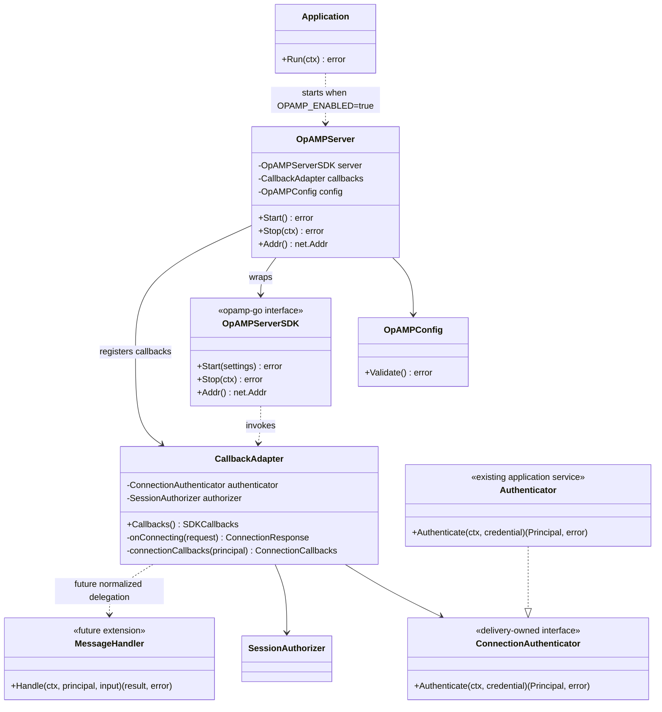

# OpAMP server

**Status:** wired into `Application.Run`, opt-in, and covered by a Mongo plus pinned Supervisor
application integration test. `OPAMP_ENABLED` defaults to `false`; enabling it starts the
listener only after Mongo identity storage, the authenticator, and mandatory callbacks are
constructed. Credentials remain required for every connection and UID binding.

Production deployments should leave the listener disabled until credential provisioning and
revocation authorization are available and the remaining C01/C04 security decisions are
approved. Non-loopback listener configuration requires TLS, and authentication remains
fail-closed when the listener is enabled.

## Responsibilities and files

| Component | Location | Responsibility |
|---|---|---|
| `OpAMPConfig` | `platform/config/config_opamp.go` | Existing environment settings, defaults, and validation |
| `OpAMPServer` | `contexts/identity/delivery/opamp/server.go` | Listener, TLS, SDK startup and bounded shutdown |
| `CallbackAdapter` | `contexts/identity/delivery/opamp/callbacks.go` | Authentication callbacks and native protocol translation |
| Connection tracking | `contexts/identity/delivery/opamp/connections.go` | Socket cleanup and callback lifetime cancellation |
| `Authenticator` | `contexts/identity/application/authentication.go` | Bounded credential verification through `IdentityVerifier` |
| Mongo verifier and UID binding | `contexts/identity/infrastructure/mongodb/verifier.go` | Hash-only credential lookup, atomic UID binding, reconnect checks, revocation fence |

Paths above are relative to `internal/`. `CallbackAdapter` replaces the former `Handler` name.
`ConnectionAuthenticator` is a delivery-owned interface implemented by the existing authenticator.
Domain/application types do not import protobufs, HTTP, or SDK types.

## Configuration and construction

`Config` embeds `OpAMPConfig`. Existing Go field selectors, flat JSON/YAML field names,
environment names, and defaults are preserved. `FLEET_SHUTDOWN_TIMEOUT` remains on
the aggregate config. `app/config.go` exposes aliases and the loader facade.

`NewServer(config, callbacks, logger)` validates mandatory dependencies and settings.
It does not bind sockets or read certificate files. `Start()` loads the configured key pair,
requires TLS 1.2 or later when TLS is configured, binds synchronously, and starts the SDK.
Plaintext remains allowed only on an explicit loopback address. The listener accepts
WebSocket upgrades; plain HTTP protocol requests receive 426. Wildcard route patterns
are rejected by the wrapper. `Addr()` exposes the bound address for diagnostics/tests.
`Application.Run` constructs the callback adapter from the Mongo verifier and bounded
authenticator, starts OpAMP when `OPAMP_ENABLED=true`, then includes the bound listener in
readiness. The lifecycle stops HTTP, OpAMP, then Mongo in reverse acquisition order.

## Connection behavior

1. The adapter authenticates the bearer credential before admitting a connection.
2. Rejected credentials return 401; unavailable or timed-out verification returns 503.
3. Connection callbacks capture the authenticated principal independently.
4. Messages must contain a 16-byte UID and pass the Mongo session authorizer. The first message
   binds the UID; reconnects must present the same UID. Conflicting UIDs reject and close.
5. Every message rechecks active credential status and stored UID. Revocation blocks the next
   callback; no separate active-session registry currently closes sockets asynchronously.
6. The bootstrap response echoes the authorized UID and advertises no server capabilities.

The SDK owns native protobuf framing. Message size uses `OPAMP_MAX_MESSAGE_BYTES`.
Malformed protocol diagnostics are redacted; raw parser errors, payloads, and credentials
are not copied into logs. The SDK's logger is adapted to fixed safe diagnostic labels.

## Lifecycle and the pinned SDK

The pinned SDK is `v0.25.1-0.20261009224415-75f79590b7a6`. Its `Stop` implementation
uses HTTP shutdown but leaves hijacked WebSocket closure as a TODO. The wrapper therefore
tracks accepted sockets, including incomplete handshakes, and closes them explicitly.
Socket tracking is technical lifecycle ownership; it is not a Fleet session registry.

`Stop(ctx)` closes admission, cancels callback contexts, closes sockets, invokes SDK stop,
and waits for registered callbacks to finish within the supplied deadline. Repeated calls
return the first stop result. Stop before Start is harmless; restart after success is rejected.
Failed startup closes acquired sockets. Application composition must serialize Start/Stop.

Connection contexts are derived from the server lifetime, not the HTTP upgrade request:
the SDK cancels that request when the upgrade handler returns. Contexts are canceled on
connection close or server stop. Technical handshake and response-write deadlines are
10 seconds; successful upgrades clear the handshake deadline. SDK writes otherwise ignore
context cancellation, so the write deadline and explicit socket closure are necessary.

The SDK does not expose an asynchronous serving-error channel. The wrapper reports fatal
listener `Accept` errors to `Application.Run` and marks OpAMP readiness unavailable; normal
shutdown closure is not treated as a runtime failure. Other SDK-internal serving failures
that do not reach the listener remain outside the wrapper's monitoring surface.

## Class diagram

## Activation and OPEN decisions

OpAMP wiring is implemented behind the default-disabled `OPAMP_ENABLED` setting. Startup
registers listener cleanup only after successful bind; readiness requires Mongo connectivity
and a bound OpAMP listener when enabled. Shutdown marks readiness draining, then stops HTTP,
OpAMP and Mongo. See [identity verification and Supervisor UID binding](identity-verification-and-supervisor-binding.md)
for first-bind, reconnect, conflict, revocation, recovery limits, and test status. Credential
provisioning/rotation and cross-system policy remain OPEN under
[C01](../../shared/contracts/fleet-management/enrollment-identity-v1.md) and
[C04](../../shared/contracts/fleet-management/opamp-integration-v1.md).
`MessageHandler` is not implemented without an approved use case and application-owned DTOs.
Native SDK client tests cover WS/WSS, auth rejection/timeout, reconnect, malformed/oversized
messages, and shutdown. Hosted pinned Supervisor v0.160.0 UID-continuity and Fleet/Mongo
binding checks passed on Ubuntu and Windows where applicable. The new Application.Run plus
Mongo/Supervisor test is queued for the next PR CI run. The application listener remains
disabled unless explicitly enabled in runtime configuration.
