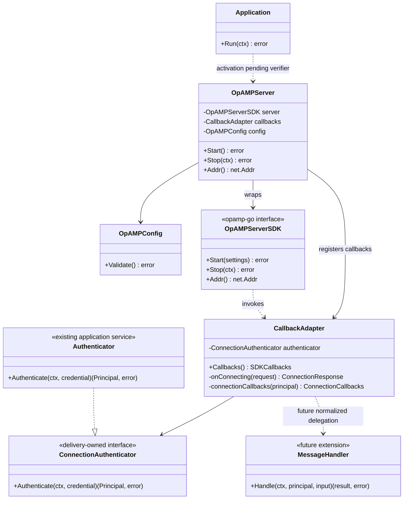

# OpAMP server

**Status:** implemented and tested server component; not activated by `Application.Run`.
The existing runtime still starts MongoDB and HTTP health routes only.
Production activation requires an approved Fleet `IdentityVerifier` implementation.
No permissive verifier or test credential source is installed in application wiring.

## Responsibilities and files

| Component | Location | Responsibility |
|---|---|---|
| `OpAMPConfig` | `platform/config/config_opamp.go` | Existing environment settings, defaults, and validation |
| `OpAMPServer` | `contexts/identity/delivery/opamp/server.go` | Listener, TLS, SDK startup and bounded shutdown |
| `CallbackAdapter` | `contexts/identity/delivery/opamp/callbacks.go` | Authentication callbacks and native protocol translation |
| Connection tracking | `contexts/identity/delivery/opamp/connections.go` | Socket cleanup and callback lifetime cancellation |
| `Authenticator` | `contexts/identity/application/authentication.go` | Bounded credential verification through `IdentityVerifier` |

Paths above are relative to `internal/`. `CallbackAdapter` replaces the former `Handler` name.
`ConnectionAuthenticator` is a delivery-owned interface implemented by the existing authenticator.
Domain/application types do not import protobufs, HTTP, or SDK types.

## Configuration and construction

`Config` embeds `OpAMPConfig`. Existing Go field selectors, flat JSON/YAML field names,
environment names, and defaults are preserved. `FLEET_SHUTDOWN_TIMEOUT` remains on
the aggregate config. `app/config.go` exposes aliases and the loader facade.

`NewServer(config, callbacks, logger)` validates mandatory dependencies and settings.
It does not bind sockets or read certificate files. `Start()` loads the configured key pair,
requires TLS 1.2 or later when TLS is configured, binds synchronously, and starts the SDK.
Plaintext remains allowed only on an explicit loopback address. The listener accepts
WebSocket upgrades; plain HTTP protocol requests receive 426. Wildcard route patterns
are rejected by the wrapper. `Addr()` exposes the bound address for diagnostics/tests.

## Connection behavior

1. The adapter authenticates the bearer credential before admitting a connection.
2. Rejected credentials return 401; unavailable or timed-out verification returns 503.
3. Connection callbacks capture the authenticated principal independently.
4. Messages must contain a 16-byte UID. This is structural validation, not UID ownership binding.
5. The bootstrap response echoes the UID and advertises no server capabilities.

The SDK owns native protobuf framing. Message size uses `OPAMP_MAX_MESSAGE_BYTES`.
Malformed protocol diagnostics are redacted; raw parser errors, payloads, and credentials
are not copied into logs. The SDK's logger is adapted to fixed safe diagnostic labels.

## Lifecycle and the pinned SDK

The pinned SDK is `v0.25.1-0.20261009224415-75f79590b7a6`. Its `Stop` implementation
uses HTTP shutdown but leaves hijacked WebSocket closure as a TODO. The wrapper therefore
tracks accepted sockets, including incomplete handshakes, and closes them explicitly.
Socket tracking is technical lifecycle ownership; it is not a Fleet session registry.

`Stop(ctx)` closes admission, cancels callback contexts, closes sockets, invokes SDK stop,
and waits for registered callbacks to finish within the supplied deadline. Repeated calls
return the first stop result. Stop before Start is harmless; restart after success is rejected.
Failed startup closes acquired sockets. Application composition must serialize Start/Stop.

Connection contexts are derived from the server lifetime, not the HTTP upgrade request:
the SDK cancels that request when the upgrade handler returns. Contexts are canceled on
connection close or server stop. Technical handshake and response-write deadlines are
10 seconds; successful upgrades clear the handshake deadline. SDK writes otherwise ignore
context cancellation, so the write deadline and explicit socket closure are necessary.

The SDK does not expose an asynchronous serving-error channel. Such failures are logged;
this wrapper does not claim the HTTP server's `Errors()` monitoring behavior.

## Class diagram

## Activation and OPEN decisions

Once the verifier is approved, app wiring constructs the authenticator, adapter, and server;
starts the listener; and immediately registers `server.Stop` in the existing lifecycle registry.
Drain before cleanup, and stop the listener before its persistence dependencies.

UID binding, duplicate-session ownership, active-session revocation, configuration publication,
push/reconciliation, and message use cases remain OPEN under
[C04](../../shared/contracts/fleet-management/opamp-integration-v1.md).
`MessageHandler` is not implemented without an approved use case and application-owned DTOs.
Native SDK client tests cover WS/WSS, auth rejection/timeout, reconnect, malformed/oversized
messages, and shutdown. These do not establish interoperability with the pinned official
Supervisor; that remains a release gate. No shared contract or gitlink was changed.
