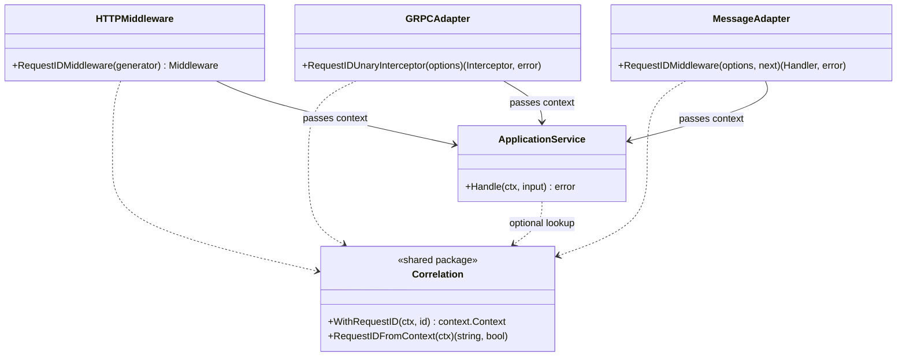

# Request correlation

The implemented adapters share an opaque request ID through `internal/shared/correlation`.
This package imports only `context`. `WithRequestID` stores a value without transforming it;
`RequestIDFromContext` returns `(id, true)` for a nonempty stored string.
An absent or empty value returns `false`. Child contexts preserve cancellation and deadlines.

## Ownership and precedence

Each adapter owns extraction, validation, generation, and failure behavior.
An existing context ID takes precedence over transport input. The adapter validates it
and fails if it is incompatible; it never silently replaces an inherited ID.
Without an inherited ID, a valid single input is reused. Missing input generates an ID.
Invalid or repeated input follows the adapter's explicitly selected policy.
Generated values are validated too. Nested wrappers therefore generate at most once.

HTTP keeps its current header, validator, and UUID generator. The old HTTP context getter
delegates to the shared getter. Invalid incoming headers are replaced; incompatible
inherited IDs and generator failures produce a generic 500. Existing health routes are unchanged.

gRPC unary calls use `grpcapi.RequestIDUnaryInterceptor`. Construction requires a lowercase,
nonreserved text metadata key, validation and generation callbacks, and `RejectInvalid`
or `ReplaceInvalid`. Optional response metadata echoes the selected ID. Nested copies
using the same key queue it once. IDs must be printable ASCII for text metadata.
Rejected input returns `InvalidArgument`; internal failures return a redacted `Internal` status.
Cancellation is preserved. Handler results and errors pass through unchanged.

Messages use `messaging.RequestIDMiddleware[T]` around `Handler[T]`.
The extractor receives context and the message and returns all candidate values.
The integration supplies validation, generation, and an explicit invalid-input policy.
Extraction, inherited-ID, and generation failures return `ErrCorrelation`; rejected input
returns `ErrInvalidRequestID`. Raw callback errors and values are not exposed.
The broker integration owns acknowledgement, retries, publishing, and dead-letter decisions.
Neither middleware mutates incoming transport metadata or message contents.
Callbacks must be safe for concurrent requests; configure them before serving traffic.

## Usage

```go
// Application and logging code can read correlation without importing an adapter.
id, present := correlation.RequestIDFromContext(ctx)

// Example integration choices, not approved Fleet metadata contracts:
interceptor, err := grpcapi.RequestIDUnaryInterceptor(grpcapi.RequestIDOptions{
    MetadataKey: "example-request-id", Validate: validateID, Generate: generateID,
    InvalidInput: grpcapi.RejectInvalid, ReturnHeader: true,
})
// Check err, then install with grpc.UnaryInterceptor(interceptor).

handler, err := messaging.RequestIDMiddleware(messaging.RequestIDOptions[Message]{
    Extract: extractIDs, Validate: validateID, Generate: generateID,
    InvalidInput: messaging.RejectInvalid,
}, handleMessage)
// Check err, then invoke handler with the broker's per-delivery context.
```

## Class diagram



## OPEN decisions

Fleet metadata/header names, ID formats, redelivery correlation, outbound propagation,
and business error codes require their owning contracts. gRPC streaming is not implemented.
Request IDs are not authentication, idempotency keys, message IDs, or trace IDs.
Response DTOs must use the selected context ID; writers never generate IDs themselves.
