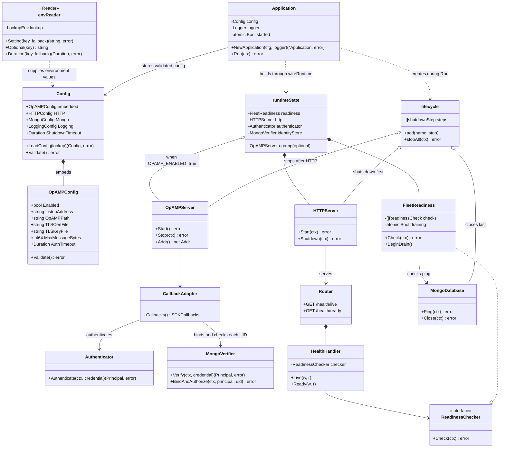

# Runtime configuration and application

**Status:** describes the bootstrap code currently implemented. It is a small composition foundation, not a complete Fleet runtime.

## Package responsibilities

- `internal/platform/env` reads injected environment values and parses durations. It distinguishes absent settings (use the caller's default) from explicitly empty required settings (error). Optional settings become empty strings when absent or empty.
- `internal/platform/config` owns the full runtime `Config`, environment names/defaults, and validation for HTTP, OpAMP, MongoDB, and logging settings.
- `Config` embeds `OpAMPConfig`; existing flat JSON/YAML names and promoted Go field selectors are preserved.
- `internal/app/config.go` provides aliases and `LoadConfig` as the application-facing facade. The configuration type itself currently lives in `platform/config`.
- `internal/app` validates inputs, assembles runtime dependencies, coordinates startup and cleanup, and owns readiness state.
- `internal/platform/mongodb` and `internal/platform/http-server` own the database and HTTP listener mechanics.

Configuration loading validates the settings before application construction. `NewApplication` validates again and requires a logger. It does not open external resources. Configuration can contain secrets, especially the MongoDB URI, so do not log or serialize it.

## Startup and shutdown today

`Application.Run` is single-use. It creates a local lifecycle registry and calls `wireRuntime`. Wiring opens MongoDB, creates the Mongo credential verifier and bounded authenticator, and starts the native OpAMP listener only when `OPAMP_ENABLED=true`. The mandatory callback adapter receives the verifier for credential checks and per-message UID binding. Wiring then creates readiness checks, builds the health router, and starts HTTP. On every exit path, readiness enters drain before cleanup runs in reverse acquisition order under one bounded shutdown context.

The running HTTP routes are `/health/live` and `/health/ready`. Readiness returns a generic unavailable response if Mongo is unhealthy, enabled OpAMP has not bound or its listener has failed, or shutdown has begun. The application waits for context cancellation, an HTTP serving error, or an unexpected OpAMP listener failure. The SDK does not expose a serving-error channel, so the wrapper observes fatal listener `Accept` errors.

## Class diagram

## Reading the diagram

The lifecycle registry is local to each `Run`; it is not a field on `Application`. When enabled, acquisition order is MongoDB, OpAMP, then HTTP. Reverse cleanup shuts HTTP down first, then OpAMP, then MongoDB. OpAMP defaults to disabled, and an enabled listener still requires authenticated credentials and binds UID only after verification.

## Not implemented yet

The [OpAMP server component](opamp-server.md) is wired into `Application.Run` behind `OPAMP_ENABLED`, which defaults to `false`. Real Supervisor plus Mongo tests exercise startup, readiness, authenticated UID binding, shutdown, and listener-bind failure cleanup through the application. There is no service command entrypoint, credential provisioning/revocation API, or full Fleet API wiring; production OpAMP should remain disabled until those security prerequisites and remaining C01/C04 decisions are resolved. Keep config defaults in their owning configuration sections and reusable environment parsing in `platform/env`.
