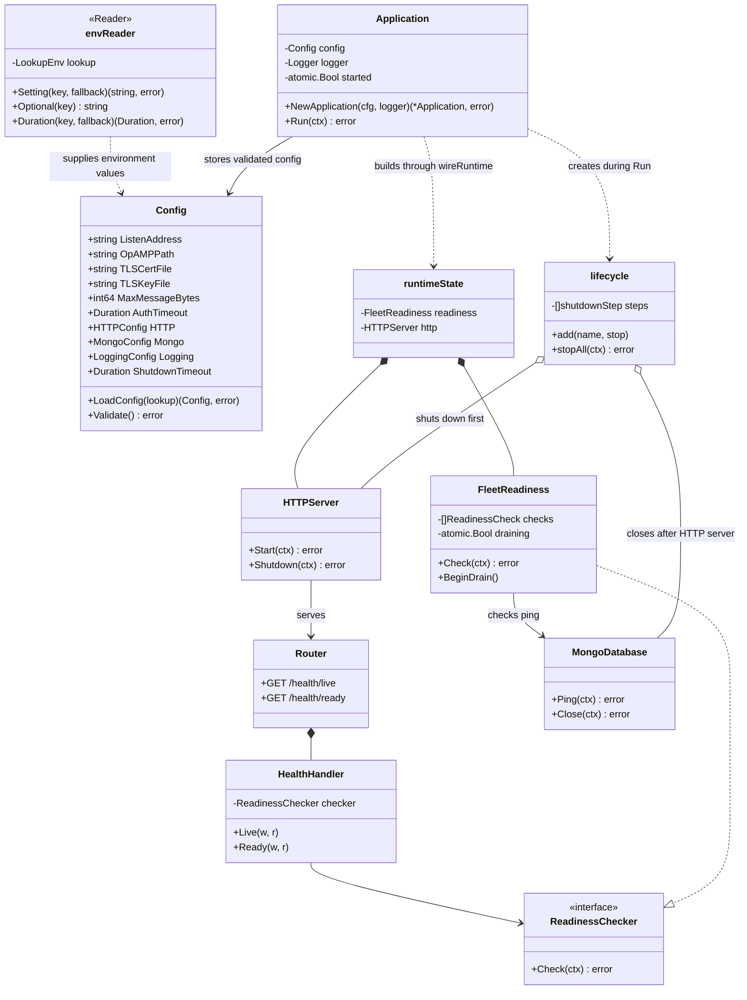

# Runtime configuration and application

**Status:** describes the bootstrap code currently implemented. It is a small composition foundation, not a complete Fleet runtime.

## Package responsibilities

- `internal/platform/env` reads injected environment values and parses durations. It distinguishes absent settings (use the caller's default) from explicitly empty required settings (error). Optional settings become empty strings when absent or empty.
- `internal/platform/config` owns the full runtime `Config`, environment names/defaults, and validation for HTTP, OpAMP, MongoDB, and logging settings.
- `internal/app/config.go` provides aliases and `LoadConfig` as the application-facing facade. The configuration type itself currently lives in `platform/config`.
- `internal/app` validates inputs, assembles runtime dependencies, coordinates startup and cleanup, and owns readiness state.
- `internal/platform/mongodb` and `internal/platform/http-server` own the database and HTTP listener mechanics.

Configuration loading validates the settings before application construction. `NewApplication` validates again and requires a logger. It does not open external resources. Configuration can contain secrets, especially the MongoDB URI, so do not log or serialize it.

## Startup and shutdown today

`Application.Run` is single-use. It creates a local lifecycle registry and calls `wireRuntime`. Wiring opens MongoDB, registers its close operation, creates a readiness checker backed by Mongo ping, builds the health router, then starts the HTTP server. On every exit path, the application marks readiness as draining and calls registered cleanup steps in reverse acquisition order under one bounded shutdown context.

The running HTTP routes are `/health/live` and `/health/ready`. Readiness returns a generic unavailable response if Mongo is unhealthy or shutdown has begun. The application currently waits for context cancellation or an unexpected HTTP serving error. It does not yet start an OpAMP listener or background worker.

## Class diagram

## Reading the diagram

The lifecycle registry is local to each `Run`; it is not a field on `Application`. MongoDB and the HTTP server are acquired in that order, so reverse cleanup shuts HTTP down before MongoDB. The app layer owns this sequencing; platform packages do not import `app`.

## Not implemented yet

There is no `BackgroundWorker` interface, OpAMP server lifecycle, or full Fleet API wiring in the current application bootstrap. Add those only with an owning feature and explicit startup, readiness, and shutdown behavior. Keep config defaults in their owning configuration sections; keep reusable environment parsing in `platform/env`.
