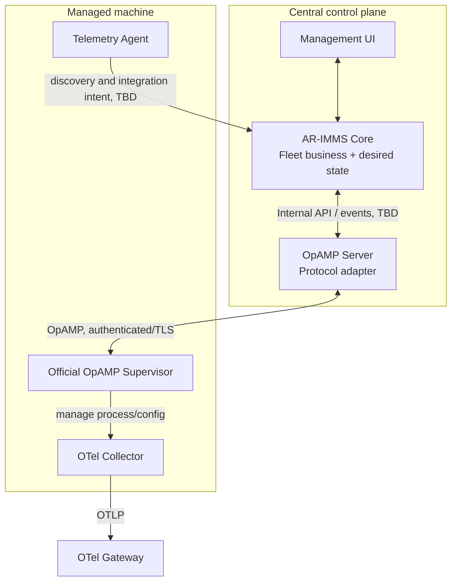

# System overview — OpAMP Server

**Status:** target architecture; not a statement of completed features.
**One sentence:** a protocol service that connects authenticated managed agents to Fleet decisions owned by AR-IMMS Core.

## 1. Responsibilities

| Component | Owns | Does not own |
|---|---|---|
| Fleet UI | Human interaction and visualization | OpAMP protocol |
| Core Backend (NestJS) | IAM, enrollment, installation/node binding, desired revisions, rollout decisions, audit | Long-lived OpAMP socket and Collector OS process |
| **OpAMP Server (Go)** | OpAMP listener, auth adapter, session ownership, protocol processing, capability negotiation, config transport, status normalization | Business registration, asset topology, rollout policy, final desired state |
| Official OpAMP Supervisor | OpAMP client, Collector process lifecycle and configuration application | Fleet IAM, asset topology, service discovery |
| AR-IMMS Telemetry Agent | Local discovery, integrations, resource inventory, local preparation | OpAMP Server protocol, duplicate Collector process control |
| OTel Collector | Receivers/processors/exporters; OTLP data | Fleet business decisions |

**Important:** OpAMP itself can manage other vendors' agents; the **official Collector Supervisor** is specifically for Collector. Other managed agents would use their own OpAMP client or supervisor.

## 2. Four design rules

1. **Core owns desired state**. Server may cache delivery state, never silently become a second authority.
2. **One Collector process owner**. Supervisor manages Collector; Telemetry Agent must not concurrently restart the same process.
3. **Do not conflate identities**. Core installation identity and OpAMP `instance_uid` have different meanings; authorization requires an authenticated association.
4. **Separate control and data planes**. OpAMP transports control/status; Collector emits metrics/logs/traces over OTLP.

## 3. Capability boundaries

| OpAMP capability / concern | Server responsibility | Core responsibility |
|---|---|---|
| Agent description/status | Validate/normalize/forward | Store meaningful view/history |
| Remote config | Check supported capability; send and correlate result | Select target, approve content/revision |
| Effective config | Accept/report when supported | Drift/history decisions |
| Connection settings | Transport when explicitly supported | Policies/secrets/authorization |
| Package management | **Deferred** | Artifact verification and rollout policy would be required |
| Custom messages | **Deferred**; explicit negotiation only | Define and version business semantics |

Do not assume every connected client supports every OpAMP feature; negotiate actual capabilities.

## 4. Reliability and security constraints

- Authenticate before accepting a production connection. Never treat `instance_uid` or arbitrary agent descriptions as a credential.
- One active connection ownership per authenticated logical instance (policy and concurrent-reconnect behavior must be specified).
- Distinguish `connected`, `report received`, `config sent`, `config reported applied`, `config failed`, and `offline`.
- Use bounded queues and message size limits, cancellation, deadlines, and secret redaction.
- Losing OpAMP connectivity should not automatically stop Collector telemetry; supervisor behavior must be tested.

## 5. What is deliberately unresolved

- Core↔OpAMP integration transport (internal REST/events), auth credentials and event schema.
- Identity mapping between enrolled Agent Installation, Supervisor and OpAMP `instance_uid`.
- Exact integration data path from Telemetry Agent to Core and configuration compilation location.
- Reconnect conflict handling, retention, high availability and rollout policy.

These belong in [cross-service contracts](../../shared/contracts/README.md) before implementation is coupled.

**Further reading:** [Flows](flows.md) · [Clean architecture](clean-architecture.md) · [Upstream protocol](https://opentelemetry.io/docs/specs/opamp/).
