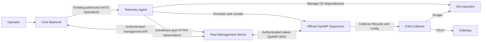

# Fleet Management Server — system overview

**Status:** accepted B+ target ownership, not a statement of implemented features. The [shared Fleet overview](../../shared/architecture/fleet-management/overview.md) and [C01–C04 contract index](../../shared/contracts/fleet-management/README.md) govern cross-system decisions. Wire examples and unresolved choices retain their PROPOSED/OPEN status.

## Responsibility split

| Component | Authority and work |
|---|---|
| Core Backend | Public control entrypoint, IAM, Node/Asset binding, business authorization and audit; submits authorized typed intent |
| Fleet Management Server | Invitations, registration, credential lifecycle, desired Collector policy/revisions, durable publications, OpAMP sessions, observation projections/freshness and execution audit |
| Telemetry Agent | Stable installation UUID, host evidence, local inventory/health, protected credentials, Supervisor provisioning, OS exporters and existing Core-authorized Operations |
| Official OpAMP Supervisor | Native OpAMP client and exclusive Collector process/configuration executor in Fleet-managed native mode |
| OTel Collector | Collection, processing and OTLP export |

Core and Fleet own separate persistence. Fleet does not reach into Core's database, and Core does not write Fleet's desired/publication records. Their audit trails correlate by operation IDs. Fleet uses `opamp-go` for protocol transport; it does not implement Supervisor behavior or a custom telemetry engine.

## Identity and evidence

- `agent_id` reuses the Agent's persisted installation UUID. Fleet owns registration and credential authority; Core owns confirmed Node binding.
- `host_id`, hostname and environment classification are observations, not authentication or proof of physical placement. Duplicate host evidence does not merge installations.
- OpAMP `instance_uid` is a protocol identity bound to an authenticated installation. Exact UID provisioning/mapping remains OPEN in C01/C04.
- Keep desired, published, OpAMP-reported, effective, Collector ready, and OTLP delivered separate. Sending configuration never proves it applied.

## Interfaces and decisions

Core→Fleet management and Agent→Fleet enrollment/observations use authenticated HTTPS; Fleet↔official Supervisor uses native OpAMP over WSS. Exact REST paths, schemas, credential scopes/rotation, config composition, retry/retention and migration remain PROPOSED/OPEN in [C01–C04](../../shared/contracts/fleet-management/README.md). Do not turn illustrative paths or payloads into implementation contracts without owner approval.

Keep legacy Agent-managed Collector, current Core-backed Supervisor mode, and future Fleet-backed Supervisor mode distinguishable until controlled migration. One Collector lifecycle owner may operate per installation. See the [shared roadmap](../../shared/integration/fleet-management/implementation-roadmap.md) and [local flows](flows.md).

## Current repository state

The repository has configuration, MongoDB connectivity, application lifecycle, HTTP health/readiness, and an authentication use case. The [OpAMP listener and callback adapter](opamp-server.md) are tested components; activation in application wiring awaits a production identity verifier. There is no service entrypoint, durable Fleet record model, enrollment flow, Core API, configuration publication, or observation projection. The ownership sections above describe the target.
