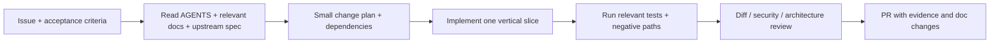

# Coding policy — human and AI contributors

**Goal:** reliable, maintainable Go protocol service with a small amount of deliberate architecture. This policy applies to generated code too.

## 1. Engineering standards

| Principle | Required behavior |
|---|---|
| Correctness over speed | Verify upstream protocol behavior; do not fabricate OpAMP fields/capabilities. |
| Clean boundaries | Domain/application independent of transport, framework, protobuf and storage. |
| Security by default | Authenticate, authorize, TLS outside loopback; fail closed. |
| Explicit ownership | Core owns fleet policy; Supervisor owns Collector lifecycle; Server owns sessions/protocol. |
| Minimal design | No speculative framework, registry, database or custom protocol. |
| Small changes | Prefer reviewable vertical slices and coherent commits. |
| Evidence | A claim is complete only with tests and clear evidence. |

## 2. Go conventions

- Use idiomatic Go, `gofmt`, `go vet`, meaningful package names, constructor injection and explicit error wrapping (`fmt.Errorf("...: %w", err)`).
- Prefer standard library before new dependencies. Pin direct dependency versions and commit `go.sum`.
- Put `context.Context` first on I/O and blocking operations; propagate cancellation/deadlines. No fire-and-forget goroutines without lifecycle ownership.
- Avoid global mutable state. Protect shared state with mutexes or message ownership; run `go test -race`.
- Bound sizes, queues, retries, concurrency and timeout. Document backpressure/drop behavior.
- Exported types/functions should have useful GoDoc explaining purpose/contract; non-obvious business rules should have why-comments, not line-by-line narration.
- Target **≤450 lines per production Go file** (tests exempt). Split by responsibility, not arbitrary line count.
- Keep PRs about **300–400 changed LOC** when practical; justified exceptions are fine when a cohesive change is larger.

## 3. Architecture and protocol guardrails

- `transport/opamp` is the translation boundary; protobufs must not leak into core domain/application models.
- Check negotiated client/server capabilities before sending optional messages.
- Treat connections as transient and identity as authenticated. An OpAMP `instance_uid` is an identifier, **not proof of identity**.
- Maintain a clear status vocabulary: connected, reported healthy, delivery attempted, applied, failed, unknown, offline.
- Preserve remote-config hash and revision correlation; do not mark applied from send success or from a stale response.
- Do not invent an Agent↔Supervisor integration API: record unresolved cross-repo contracts in `docs/shared/contracts`.
- Do not add proprietary custom OpAMP messages without reviewing upstream extension mechanisms and compatibility.

## 4. Security checklist

- Use TLS for non-loopback endpoint; verify peer/credential against configured trusted authority.
- Never log tokens, secrets, raw sensitive configuration or unauthenticated payload dumps.
- Set explicit maximum inbound message size and connection concurrency where supported.
- Reject unsupported authorization states and expired/revoked credentials; do not allow anonymous production mode.
- Rate-limit/restrict connection attempts where appropriate; do not reveal credential internals through errors.
- Minimize privileges of deployment identities and CI workflows; no production secret in repo/fixtures.

## 5. AI coding workflow

**AI assistant must:** state assumptions, cite upstream source for unfamiliar protocol semantics, distinguish implemented vs proposed, follow existing context boundaries, avoid unrelated refactoring, and report commands actually run. When uncertain, leave a TODO with rationale and ask for review rather than silently guessing.

**AI assistant must not:** bypass quality checks, add hidden compatibility fallbacks, weaken TLS/auth, introduce new background processes or databases without an ADR, or modify Telemetry Agent / Core repos as part of a server-only change.

## 6. Definition of done

- Behavior and failure cases are demonstrated by tests.
- `gofmt`, `go vet`, tests with race detector, and build pass for affected packages.
- User-visible operations and failure modes are documented; relevant diagrams updated.
- No secrets in code or test logs; PR explicitly states security implications.
- If contract changed, update shared proposal and obtain cross-service review before assuming it is authoritative.
