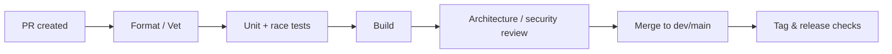

# Quality gates — build, review and release

## Pipeline at a glance



## Required for every PR

| Gate | Command or evidence | Fail if |
|---|---|---|
| Formatting | `gofmt -l` on tracked `.go` files yields nothing | Unformatted Go |
| Static checks | `go vet ./...` | Vet errors |
| Unit/concurrency | `go test -race ./...` (CI Linux) | Test failure or data race |
| Build | `go build ./...` | Compilation failure |
| Dependencies | `go mod tidy` leaves no uncommitted changes | Inconsistent modules |
| Architecture | Reviewer verifies inward dependency rule | Domain imports protocol/infra |
| Security | Verify auth, redaction, no secrets, bounded input | Unsafe configuration or secret exposure |
| Documentation | Relevant diagrams, README and contract proposal updated | Behavior or ownership drift |

**CI job name recommendation:** `quality` (use exactly this name when configuring required GitHub status checks).

## Required for protocol / connection changes

- Integration test with a real `opamp-go` client; fake Core verifier permitted only in tests.
- Multi-client concurrent connections; disconnect/reconnect; rejected auth; revoked credential; duplicate identity/conflicting session.
- Malformed/oversized payload and cancellation/timeout behavior.
- Confirm server capability flags reflect actual supported behavior.

## Required for remote configuration changes

- Client supports/doesn't support remote configuration.
- Offline delivery is pending/failed with reason, never silently applied.
- Correlate revision and hash to applied/failed reports.
- Old/unknown hash cannot overwrite current revision status.
- Reconnect resynchronizes with latest desired state.

## Release gate

- All required PR checks pass on protected branch.
- Tag from reviewed commit, reproducible build and checksum generated.
- Dependency vulnerability scan (`govulncheck`) and software supply chain controls should be added **before production release**; not claim these are currently wired.
- TLS/auth hardening verified against a real Supervisor, not just a mock client.
- Release notes: compatibility, migrations, operational risks, rollback plan.

## Continuous delivery policy

CI is required from first PR. Automated deployment is **not** part of bootstrap. Separate deploy workflows need a reviewed ADR, environment protection and credential management before activation.

## Branch protection suggestion

- `main`: pull requests, at least 1 independent review, resolved conversations, linear history, required `quality` check; no bypass by AI bots.
- `dev`: PR preferred; quality check required; no direct pushes except explicitly approved bootstrap/maintenance.
- Do not enable a required check before its workflow reports the exact check name, or merging may be blocked.

## Evidence template for PR

```text
Problem / intended behavior:
Architecture boundary touched:
Tests run (exact commands + result):
Failure paths covered:
Security / compatibility impact:
Docs / diagrams updated:
Open decisions or limitations:
```
