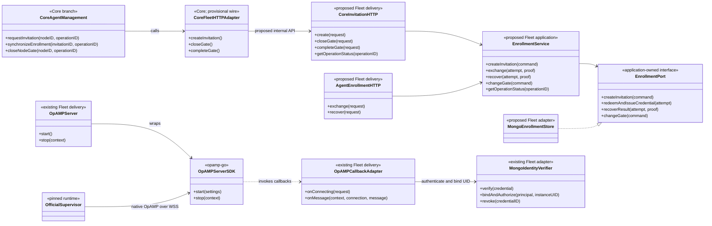

# Agent Registration — Implementation Plan

**Review status:** Approved and implemented locally; cross-system contracts remain open.
**Implementation branch:** `feat/agent-registration`, based on the current Fleet feature branch.
**Contract status:** Fleet ownership boundaries are accepted. C01/C04 wire, security, recovery, and lifecycle details remain proposed/open.
**Implementation note:** See [Agent Registration in Fleet](../architecture/agent-registration.md) for the implemented flow, provisional routes, tests, and current evidence.

## Implementation outcome

Fleet now has the invitation, exchange/recovery, Core gate/status adapters,
Mongo persistence, and application wiring described in the approved design.
The OpAMP server reuses the existing identity verifier and remains disabled by
default. Current implementation details, verification evidence, and open
contract decisions are recorded in the [architecture document](../architecture/agent-registration.md).

## Pre-implementation baseline

- Fleet has a Mongo-backed identity verifier that stores credential digests, authenticates active credentials, binds Supervisor `instance_uid`, and fences binding against revocation. `agent_id` and UID are separate. See `internal/contexts/identity/infrastructure/mongodb/verifier.go`.
- `internal/contexts/identity/application` has authentication and session authorization; `delivery/opamp` has the callback and server adapters. `internal/app/wiring.go` composes these. `internal/app/router.go` currently mounts only health routes.
- No Fleet invitation, Agent exchange/recovery, Core management HTTP routes, or enrollment gate persistence exists. `StoreActiveCredential` alone cannot atomically consume an invitation and persist an exchange recovery result.
- On Core branch `feat/fleet-core-integration-design` (reviewed at `d49027243f06480080694d10ca8f425c67924513`), Core has invitation/synchronization/gate orchestration, outbound adapters, and a durable operation journal. Its own design marks Fleet wire behavior provisional and unverified.
- On Agent branch `dev`, enrollment is implemented against Core's legacy `POST /api/v1/agent-enrollments`: the request carries `bootstrap_token`, an immutable `enrollment_attempt_id`, and installation/software/environment metadata. Agent persists the attempt in SQLite and keeps token values in its protected credential store. Its response validator requires a control-plane URL on the configured Core origin. This is not the C01 Agent→Fleet invitation exchange and it does not currently accept Fleet's OpAMP endpoint/credential response. See [Agent enrollment client](https://github.com/AR-IMMS/telemetry-agent/blob/dev/internal/coreapi/enrollment_client.go), [Agent enrollment model](https://github.com/AR-IMMS/telemetry-agent/blob/dev/internal/enrollment/model.go), and [Agent enrollment service](https://github.com/AR-IMMS/telemetry-agent/blob/dev/internal/enrollment/service.go).
- Agent's current real-Core enrollment integration test exercises Core bootstrap issuance, response-loss recovery, and revocation; it is not a Fleet enrollment test. See [Agent/Core enrollment integration test](https://github.com/AR-IMMS/telemetry-agent/blob/dev/docs/local/testing/telemetry-agent-core-enrollment-integration.md).
- C01 accepts responsibility boundaries but leaves endpoints, schemas, authentication, idempotency retention, recovery proof/window, Node-authorization freshness, and lifecycle races open. C04 accepts the OpAMP boundary but leaves credential/session details proposed or test-required.

## Recommended design

Keep this first slice in the existing `identity` bounded context. Add only the identity-domain state and application-owned persistence port needed for invitation, attempt recovery, credential issuance, and gate transitions. Keep HTTP and Mongo details in delivery/infrastructure adapters; compose them in `app`.

1. **Core invitation:** accept only requests authenticated as the agreed Core service. Derive actor attribution from trusted service context, never request JSON. Persist operation ID, actor, Node, request fingerprint, status, expiry, and a hash of the invitation secret. If approved retries must return the same pending secret, keep that response encrypted only until redemption/cancellation/expiry. Same operation and fingerprint replays the same invitation outcome; changed actor or request conflicts.
2. **Agent exchange/recovery:** require the persisted `agent_id`, stable `enrollment_attempt_id`, invitation secret, and an agreed attempt recovery proof. Atomically consume the invitation, enforce one installation per allowed Node/Agent rule, create a credential digest, and persist the recoverable result. A retry with the same attempt and proof returns the same result; a different attempt cannot redeem it. Host evidence does not authenticate or rebind an installation.
3. **Secret handling:** return invitation and credential secrets only to their authorized recipient over TLS; never log, audit, trace, or store raw values. For approved lost-response recovery, retain the needed response only as encrypted escrow for an agreed window and erase it at terminal state/expiry. Encryption key source and retention are open decisions.
4. **Core lifecycle gate:** invitation creation and exchange both require an OPEN gate. Closing a gate must serialize with exchange and return only after subsequent exchanges are rejected. Core's current branch journals the operation, closes Fleet's gate, commits the Core lifecycle change, then finalizes the gate as CLOSED; a business abort restores the previous gate state. If the Core transaction outcome is unknown, it leaves the gate closed and retries from the journal. Fleet must make gate close and exchange contend on the same atomic guard; use a Mongo transaction/conditional gate-version update only after confirming the supported Mongo topology. Core must not proceed when gate close has an unknown outcome.
5. **Core binding synchronization:** after Fleet redeems an invitation, expose a durable, secret-free status/read operation that Core can query by its stable operation ID. Core owns the Node↔installation binding update and retries it from its operation journal; Fleet does not write Core persistence or claim a distributed transaction. The trigger and authorization for synchronization remain open.
6. **OpAMP:** reuse the existing verifier, authenticator, and callback adapter. Bind UID only after successful credential authentication. A different UID conflicts; no automatic remapping. Keep production OpAMP disabled until service authentication, TLS, credential scope/expiry, revocation authorization, and C01/C04 details are approved.

**Cross-repository prerequisite:** the Agent's current enrollment adapter targets Core directly and expects a Core-bound result. Agent owners must review a Fleet exchange adapter that consumes the approved Fleet invitation/attempt contract, persists the returned Fleet credential in its protected credential store, and provisions the approved Fleet OpAMP endpoint. Core's current routes and Agent's current Core enrollment remain legacy until an explicit cutover; do not claim an end-to-end Fleet flow from Fleet-only changes.

## Cross-system mismatch record

| Concern | Current Core / Agent behavior | C01/C04 target | Review consequence |
|---|---|---|---|
| Approval secret | Core issues a bootstrap token for a Node; Agent submits it to Core. | Core requests a Fleet invitation; Agent exchanges that invitation with Fleet. | Existing token is not evidence that Fleet invitation semantics are implemented. |
| Exchange request | Agent posts `bootstrap_token`, `enrollment_attempt_id`, `installation.id`, software/environment, and metadata to Core `/api/v1/agent-enrollments`. | C01 example sends `invitation_token`, `enrollment_attempt_id`, `agent_id`, and optional identity evidence to a proposed Fleet endpoint. | Both route and request shape differ; C01 example is not approved wire. |
| Retry/recovery | Agent persists one immutable attempt and protected bootstrap-token reference, then retries it against Core; current integration test simulates lost response from Core. | C01 requires proof of the same attempt and the same Fleet result; proof form and retention remain open. | Must agree whether invitation secret plus attempt ID is sufficient proof or a separate secret is required. Existing Core behavior does not prove Fleet recovery. |
| Success response | Agent validates a Core binding, bearer access token, and `control_plane.base_url` on the configured Core origin. | C01 draft shows a Fleet credential reference/secret and OpAMP endpoint. | Agent cannot currently accept or provision the proposed Fleet result; response schema and credential scope need joint review. |
| Supervisor connection | Fleet has the OpAMP verifier/server; the current Agent enrollment result points to Core, not a Fleet OpAMP endpoint. | Supervisor connects to Fleet using Fleet-issued credentials, then Fleet binds its UID to `agent_id`. | Full enrollment-to-OpAMP flow has not been proven across these repositories. |
| Core management | Core branch has proposed invitation, operation-status, and Node gate HTTP adapters with operation IDs and delegated actor context. | C01 accepts ownership but leaves auth, endpoint/schema, idempotency and gate semantics open. | Do not implement the Core adapter's provisional paths or actor fields as approved Fleet contract. |

Core's adapter currently proposes concrete invitation and gate paths, fields, and replay behavior. Those are not approved Fleet contracts. Implement compatible routes only after Core, Fleet, and Agent owners agree the wire contract.

```mermaid
sequenceDiagram
    participant Core
    participant Journal as Core operation journal
    participant Fleet
    participant DB as Fleet persistence
    participant Agent
    Core->>Journal: persist operation before lifecycle call
    Core->>Fleet: close gate with same operation ID
    Fleet->>DB: serialize gate close with invitation/exchange
    Note over Fleet,DB: If exchange wins first, close reports the binding; if close wins, exchange is rejected
    Fleet-->>Core: closed gate + version
    Core->>Core: commit Node lifecycle change and outcome
    alt Core commit
        Core->>Fleet: finalize gate CLOSED
    else known business abort
        Core->>Fleet: restore previous gate state
    else Core outcome unknown
        Core->>Journal: retain pending stage; keep gate closed
        Note over Core,Journal: Retry/recovery uses the same operation ID
    end
    Agent->>Fleet: exchange invitation
    Fleet->>DB: require OPEN gate in atomic exchange
```

## Original implementation sequence

1. Align the Fleet invitation, exchange/recovery, gate, and status contract with Core and Agent owners; record approved and still-open fields separately.
2. Add the Fleet identity-domain rules and Mongo persistence/migration, including atomic exchange and gate serialization plus recovery-secret handling.
3. Add Fleet application use cases and approved HTTP adapters; wire them through `app` without adding business rules to the composition root.
4. Coordinate the separate Agent change that replaces or extends its Core-only enrollment client and provisions Fleet credentials/OpAMP endpoint. Keep legacy Core enrollment available until a reviewed cutover plan exists.
5. Run Fleet Mongo/concurrency tests, Agent restart/recovery tests against the approved contract, and the pinned Supervisor end-to-end connection test. Only then assess production activation prerequisites.

## Proposed files

```text
internal/contexts/identity/
  domain/
    principal.go                    # existing
    enrollment.go                   # invitation, attempt, gate state and rules
  application/
    authentication.go               # existing
    session_authorization.go        # existing
    enrollment.go                   # use cases and validation
    enrollment_port.go              # application-owned persistence port; same package
  infrastructure/mongodb/
    verifier.go                     # existing; keep OpAMP verification behavior
    enrollment_store.go             # atomic invitation/exchange/recovery/gate adapter
    migrations.go                   # immutable schema migration; startup index reconciliation
  delivery/
    http/
      core_invitations.go           # Core-facing adapter, after contract approval
      agent_enrollment.go           # Agent exchange and recovery adapter
    opamp/                          # existing callback/server adapter
internal/app/
  router.go                         # mount approved HTTP routes
  wiring.go                         # compose store, use cases, handlers and routes
```

No new context is proposed yet: invitation issuance creates the credential lifecycle consumed by the existing identity context. If later requirements establish independent ownership or lifecycle, revisit that boundary rather than adding a speculative context now.

## Class diagram

Solid `existing` components are in Fleet today; `proposed` components are not implemented. Core adapter details are provisional, not an approved API.



## Verification plan

- **Unit:** request validation; actor provenance; invitation expiry; operation fingerprint replay/conflict; attempt proof; secret redaction; terminal states; duplicate Agent/Node rules.
- **Mongo integration:** concurrent invitation and exchange; same-attempt replay; different-attempt rejection; process restart recovery; transactional failure rollback; gate close racing exchange; unique Agent and UID constraints; revocation; verify raw secrets are absent from ordinary records.
- **Core synchronization:** after enrollment, repeat the status lookup and Core sync operation after simulated response loss/restart. Confirm Fleet status is durable and contains no replayable secret after redemption; confirm Core updates its binding idempotently from its own journal.
- **Pinned Supervisor:** run v0.160.0 against the actual Fleet app wired to Mongo. Enroll, connect, bind UID, stop/restart with retained state and reconnect; repeat with fresh state and confirm Fleet rejects automatic rebinding. Verify revoked credentials cannot reconnect. Run on supported Ubuntu and Windows runners where the integration dependencies are available.
- **Quality gates:** repository format, unit/integration tests, race detector, lint, vet, and build. Integration jobs must fail when required Mongo/Supervisor dependencies are missing rather than silently skip.

## Open cross-system decisions before production

1. Core service authentication and trusted delegated-actor format; TLS/mTLS provisioning and rotation.
2. Approved route, schema, status, and error contract for invitation, exchange, recovery, and gate operations.
3. Invitation idempotency scope/retention and whether a pending invitation secret can be replayed to Core.
4. Agent recovery proof format, secret escrow encryption/key source, and recovery retention window.
5. Cross-service approval for the local one-Agent-per-Node and one-active-credential-per-Agent rule, Core authorization freshness, invitation cancellation, and gate behavior for in-flight exchanges.
6. Credential audience/scope, expiry, rotation delivery, and controlled migration/cutover from existing Core-owned enrollments.
7. Mongo transaction topology required for atomic exchange and gate serialization; current CI evidence does not establish transaction support on every deployment topology.
8. Agent migration/cutover behavior: how existing Core-bound installations move to Fleet, whether stable Agent attempt state can be reused, and how rollback avoids two active authorities.

The implementation keeps these wire and security details provisional. Local code
and tests do not approve cross-service contracts or authorize production OpAMP
activation.
