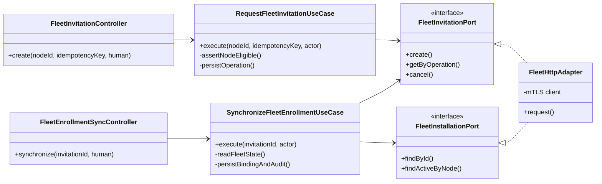
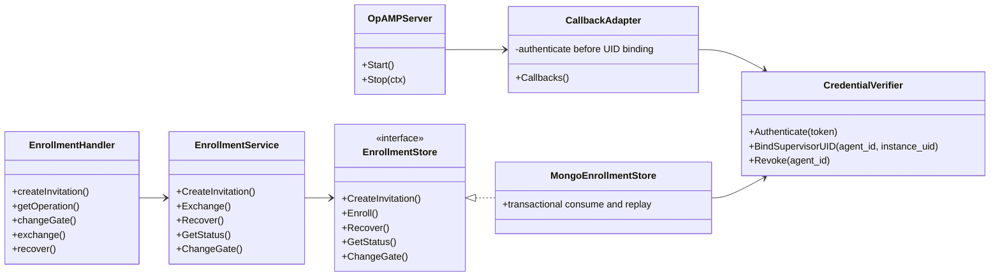
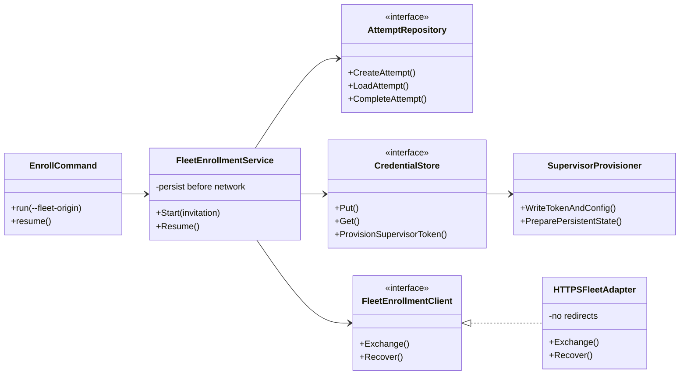

# Agent Registration End-to-End Implementation Plan

> **Approved for implementation on 2026-11-23.** This plan covers coordinated changes across Core, Fleet Manager, and Telemetry Agent. Runtime implementation is present on the existing branches; the final live three-service UAT remains pending the prerequisites listed in the execution audit.

**Goal:** Complete a production-shaped registration flow from human-authorized Core invitation through Fleet enrollment, secure Agent credential storage, official Supervisor OpAMP authentication/UID binding, Core binding synchronization, and a separately verified OTLP signal.

**Architecture:** Core remains the human and Node authority. Fleet is the credential and OpAMP authority. Agent remains the installation identity and secure provisioning owner. REST success/error DTOs follow the shared Fleet API baseline conventions selected below; native OpAMP remains protobuf/WSS.

**Tech stack:** NestJS/TypeScript Core; Go Fleet and Agent; MongoDB Fleet/Core; Agent SQLite and OS-protected credential storage; official OpAMP Supervisor v0.160.0; OpenAPI 3.1.2.

**Specs:**
- Shared baseline: docs/shared/contracts/openapi/fleet-api-baseline.openapi.yaml
- Registration proposal: docs/shared/contracts/openapi/agent-registration-v1-proposal.openapi.yaml
- C01 identity / C04 OpAMP profile in docs/shared/contracts/fleet-management/
- Per-repository AGENTS.md and Fleet docs/local/development/CODING_POLICY.md

## Global Constraints

- Preserve accepted ownership separately from proposed/approved wire details.
- Keep agent_id, node_id, host evidence, credential_id, and Supervisor instance_uid distinct.
- Authenticate credentials before UID binding; never trust host evidence or caller-supplied actor IDs as authority.
- Keep Core/Fleet persistence separate and use mTLS APIs.
- Protect and redact secrets; bound retries and response escrow.
- Keep enrollment and OpAMP disabled by default until security and integration gates pass.
- Preserve the existing Core enrollment path until an explicit migration is approved.
- Preserve unrelated changes in all three repositories.

## Review Focus

- Lost create/exchange response: same operation recovers same invitation/result without creating a second credential.
- Agent restart during pending enrollment: resume reuses persisted attempt, token, proof, and agent_id.
- Fleet revoked credential: Supervisor reconnect and subsequent callbacks fail closed.
- Node retirement racing exchange: gate and binding outcomes remain deterministic.
- Supervisor state reset: changed instance_uid is rejected pending authorized recovery.

---

## Current verified starting points

| Repo | Branch / SHA | Relevant present behavior |
|---|---|---|
| Fleet Manager | feat/agent-registration / e3ebb2a4eb91806f2452ec5671a35cb09687f008 | Provisional invitation, exchange, recovery, status, and gate routes; Mongo persistence; enrollment disabled by default; App wiring and OpAMP listener are independently disabled by default. |
| Core backend | feat/fleet-core-integration-design / 0aa77ad50c21b1b6b92a1a326489ebac63530547 | Human-authorized invitation + sync use cases and mTLS adapter; route/body mismatches with Fleet; Fleet installation reads required for eligibility/sync. Legacy Core enrollment remains. |
| Telemetry Agent | chore/v0.1.4a-next / 15cbe300ef64fa96d1eeacc53800957f1a6f7f61 | Production enrollment is Core-only. Fleet-shaped path is test-only. Existing Agent identity, SQLite attempt journal, protected credential store, Supervisor token/config provisioning, and OTLP test sinks are reusable. |

## Shared REST conventions to approve

**Recommendation:** adopt the baseline X-Request-Id header, baseline Problem response, and Idempotency-Key header for the new Fleet REST operations. Keep operation-specific success JSON direct for Core↔Fleet and Agent↔Fleet to match Fleet's existing handlers and Core's adapter boundary; keep Core's public API on its existing {data, meta} envelope. The baseline permits each operation to state envelope adoption. Update the registration OpenAPI to reference the baseline components instead of duplicating Problem/request-ID schemas, and align both files to OpenAPI 3.1.2.

### Core → Fleet invitation request

Headers: Core mutual TLS; Idempotency-Key; X-ARIMMS-Operation-Id; X-ARIMMS-Actor-Id for audit attribution only; optional X-Request-Id.

```json
{
  "schema_version": 1,
  "operation_id": "7ee1d0a0-1ab2-4a30-82ca-84c9c8f1fb62",
  "node_id": "a3cb4e2c-15c1-4c3d-8cc9-110a47ac7001",
  "requested_ttl_seconds": 600
}
```

### Fleet → Core invitation response

```json
{
  "operation_id": "7ee1d0a0-1ab2-4a30-82ca-84c9c8f1fb62",
  "invitation_id": "inv_01JEXAMPLE",
  "node_id": "a3cb4e2c-15c1-4c3d-8cc9-110a47ac7001",
  "status": "PENDING",
  "expires_at": "2026-11-23T12:10:00Z",
  "invitation_token": "REDACTED"
}
```

### Agent → Fleet exchange / recovery proof

Persist attempt ID, invitation token, and random proof before the first request. The same exact attempt is reused after timeout or process restart.

```json
{
  "enrollment_attempt_id": "fc555a2f-b6d1-4b0e-9d14-76c5cfdc385e",
  "agent_id": "bfbfe8c8-2bf5-4b77-86b0-29071c9ca1e5",
  "invitation_token": "REDACTED",
  "recovery_proof": "REDACTED"
}
```

### Fleet → Agent result and baseline Problem

```json
{
  "agent_id": "bfbfe8c8-2bf5-4b77-86b0-29071c9ca1e5",
  "node_id": "a3cb4e2c-15c1-4c3d-8cc9-110a47ac7001",
  "credential_id": "cred_01JEXAMPLE",
  "credential": "REDACTED",
  "credential_scope": "opamp.connect",
  "opamp_endpoint": "wss://fleet.example.net/v1/opamp",
  "credential_expires_at": null
}
```

```json
{
  "type": "about:blank",
  "title": "Invitation rejected",
  "status": 401,
  "detail": "The invitation cannot be used.",
  "instance": "/problems/req_01JEXAMPLE",
  "code": "INVITATION_REJECTED",
  "request_id": "req_01JEXAMPLE"
}
```


### Remaining JSON contracts

#### Core public invitation response (existing Core envelope)

```json
{
  "data": {
    "operation_id": "7ee1d0a0-1ab2-4a30-82ca-84c9c8f1fb62",
    "invitation_id": "inv_01JEXAMPLE",
    "node_id": "a3cb4e2c-15c1-4c3d-8cc9-110a47ac7001",
    "status": "PENDING",
    "expires_at": "2026-11-23T12:10:00Z",
    "invitation_token": "REDACTED"
  },
  "meta": { "request_id": "req_01JEXAMPLE" }
}
```

#### Agent recovery request

```json
{
  "enrollment_attempt_id": "fc555a2f-b6d1-4b0e-9d14-76c5cfdc385e",
  "agent_id": "bfbfe8c8-2bf5-4b77-86b0-29071c9ca1e5",
  "recovery_proof": "REDACTED"
}
```

#### Core operation status (secret-free)

```json
{
  "schema_version": 1,
  "operation_id": "7ee1d0a0-1ab2-4a30-82ca-84c9c8f1fb62",
  "invitation_id": "inv_01JEXAMPLE",
  "node_id": "a3cb4e2c-15c1-4c3d-8cc9-110a47ac7001",
  "status": "EXCHANGED",
  "agent_id": "bfbfe8c8-2bf5-4b77-86b0-29071c9ca1e5",
  "credential_id": "cred_01JEXAMPLE"
}
```

#### Node gate change and result

```json
{
  "schema_version": 1,
  "operation_id": "gate-close-7ee1d0a0",
  "status": "CLOSED"
}
```

```json
{
  "schema_version": 1,
  "node_id": "a3cb4e2c-15c1-4c3d-8cc9-110a47ac7001",
  "status": "CLOSED",
  "operation_id": "gate-close-7ee1d0a0",
  "version": 2,
  "bound_agent_ids": ["bfbfe8c8-2bf5-4b77-86b0-29071c9ca1e5"]
}
```

#### Core installation lookup

```json
{
  "installation_id": "bfbfe8c8-2bf5-4b77-86b0-29071c9ca1e5",
  "node_id": "a3cb4e2c-15c1-4c3d-8cc9-110a47ac7001",
  "status": "ACTIVE"
}
```

#### Cancel / revoke operation body

```json
{
  "schema_version": 1,
  "operation_id": "7ee1d0a0-1ab2-4a30-82ca-84c9c8f1fb62"
}
```

OpAMP Hello/authentication and OTLP export are protobuf protocols, not JSON REST contracts. Do not model either as a JSON endpoint.

## Sequence: target end-to-end behavior

```mermaid
sequenceDiagram
  autonumber
  actor Human
  participant Core
  participant Fleet
  participant DB as Fleet Mongo
  participant Agent as Telemetry Agent
  participant Sup as Official Supervisor v0.160.0
  participant Col as OTel Collector
  participant Obs as Observability backend

  Human->>Core: Request invitation for Node
  Core->>Core: Authenticate human; check permission and Node eligibility
  Core->>Fleet: mTLS POST invitation + stable operation/idempotency IDs
  Fleet->>DB: Persist invitation and encrypted replay secret
  Fleet-->>Core: Invitation ID, token, expiry
  Core-->>Human: Authorized enrollment instructions (no-store)
  Human->>Agent: Provide Fleet endpoint and invitation through secure prompt/input
  Agent->>Agent: Persist agent_id, immutable attempt, token reference, recovery proof
  Agent->>Fleet: HTTPS exchange with attempt_id + agent_id + invitation + proof
  Fleet->>DB: Atomically consume invitation; persist credential + encrypted recovery result
  Fleet-->>Agent: Same-installation OpAMP credential and WSS endpoint
  Agent->>Agent: Store credential with OS protections; render Supervisor config
  Agent->>Sup: Start/restart Supervisor using persistent state directory
  Sup->>Fleet: WSS OpAMP; credential + Supervisor-owned instance_uid
  Fleet->>DB: Authenticate first; bind instance_uid to agent_id; check revocation
  Fleet-->>Sup: Authenticated session
  Human->>Core: Synchronize invitation after Fleet reports exchange
  Core->>Fleet: mTLS reads invitation status and installation record
  Core->>Core: Recheck Node; persist Node↔agent_id projection and audit
  Sup->>Col: Own Collector lifecycle/configuration
  Col->>Obs: OTLP signal
  Obs-->>Human: Query/observe test signal

  Note over Core,Fleet: REST uses the approved C01 JSON contract
  Note over Sup,Fleet: Native OpAMP protobuf over WSS; UID is not authentication
  Note over Col,Obs: Telemetry delivery is a separate acceptance check
```

## Ownership class diagrams

### Core backend



### Fleet Manager



### Telemetry Agent



## Files and ownership

| Repository | Planned files / responsibility |
|---|---|
| Shared docs | Update agent-registration-v1-proposal.openapi.yaml to reuse fleet-api-baseline components and include Core-required installation reads; keep C01/C04 statuses PROPOSED/OPEN until owners approve. Examples in OpenAPI become cross-language contract fixtures. |
| Fleet | Extend internal/contexts/identity/delivery/http/enrollment.go DTOs/routes; add read-only installation lookup handlers; add cancel/revoke delivery only after approval; reuse identity application/Mongo ports; standardize Problem and X-Request-Id at the HTTP boundary. Keep credentials and UID mapping in identity context. |
| Core | Align infrastructure/fleet/fleet-invitation.http-adapter.ts, fleet-node-enrollment-gate.http-adapter.ts, fleet-installation.http-adapter.ts, fleet-http-client.ts; retain RequestFleetInvitationUseCase and SynchronizeFleetEnrollmentUseCase as owners of human authorization, Node checks, Core binding projection, and audit. |
| Agent | Add a Fleet-specific HTTP adapter and application flow under internal/identity/enrollment; extend SQLite attempt state with backend target and protected token/proof references using a migration; add --fleet-origin with a hidden invitation prompt/input; reuse existing agent_id persistence and credentials.Store Supervisor token/config provisioning. Keep existing --core-origin flow explicit and working during migration. |

## Implementation tasks after approval

### Task 1 — Freeze shared contract and JSON examples

- Decide baseline envelope adoption, route paths, error/status mapping, auth headers, invitation replay, attempt-proof storage, credential expiry/scope, and unseen gate behavior.
- Make registration OpenAPI reference baseline Problem, request-ID, and idempotency components. Add missing GET installation-by-ID and active-installation-by-Node operations required by Core's actual adapters. Specify cancellation and revocation only if included in this release.
- Add examples for create/replay, exchange/recovery, status, gate, installation lookup, and each stable Problem code.
- **Exit:** OpenAPI 3.1.2 validates; every Core client request/response has an operation/schema; all three owners approve the same SHA of the contract.

### Task 2 — Fleet REST contract conformance

- Add mTLS-authenticated operation replay and installation reads, align request field names and headers, return same secret only from exact invitation replay, keep status reads secret-free, and emit the shared Problem + request-ID convention.
- Preserve atomic invitation consume, attempt/proof match, encrypted response escrow, gate-vs-exchange serialization, and authenticate-before-UID-binding.
- Add Core-triggered revocation only when approved; commit revoke before denying future OpAMP messages/reconnect.
- Tests: mTLS wrong/missing identity; exact replay vs changed request; expired/cancelled invitation; response loss; recovery wrong proof/expiry; unknown installation; closed gate race; secret redaction; revoke vs callback race; UID reconnect/conflict.
- **Exit:** Fleet unit, Mongo integration, and race tests pass; FLEET_ENROLLMENT_ENABLED and OPAMP_ENABLED remain false by default.

### Task 3 — Core adapter alignment and binding synchronization

- Preserve IAM permission and Node eligibility checks before any Fleet call.
- Use stable Core operation/idempotency values for create retries. Recover a lost create response by replaying the same create request; operation status never returns invitation token.
- Align mTLS routes/DTOs, cancellation and gate mutation. Add adapters for the approved installation lookup routes.
- After Fleet exchange, synchronization reads secret-free invitation + installation state, rechecks Node state, then records Core Node↔agent_id binding and audit atomically. Replays must not duplicate audit or binding.
- Tests: unauthorized human/Node makes no Fleet request; mTLS and actor attribution; timeout/replay; Fleet error mapping; sync pending/retry; active binding and audit idempotence; Node retired during exchange; gate close compensation.
- **Exit:** Core integration tests pass against a real Fleet HTTP test instance; no public contract silently breaks legacy enrollment.

### Task 4 — Agent Fleet enrollment and Supervisor provisioning

- Add an explicit Fleet enrollment target/CLI path; do not repoint --core-origin or reinterpret the existing Core response.
- Reuse persisted agent_id. Before network, persist attempt ID, target Fleet origin, invitation-token reference, and independent recovery-proof reference. Keep plaintext secrets in protected storage, not SQLite, CLI arguments, environment dumps, or logs.
- On uncertain outcome, retry same immutable request, then call recovery with the same proof. Validate returned agent_id/scope/endpoint before commit. Store Fleet credential, render official Supervisor token/config, and preserve Supervisor state directory.
- Tests: hidden prompt input, TLS/redirect rejection, persistence failure before send, server commit + response drop, process restart recovery, wrong proof/attempt, credential-store failure cleanup, no plaintext leakage, Supervisor config points at Fleet WSS.
- **Exit:** Agent unit and pinned Supervisor integration pass on Linux and Windows.

### Task 5 — Full three-repository E2E and UAT evidence

- Start Core, Mongo replica set, TLS-enabled Fleet, production Agent command, pinned Supervisor v0.160.0, Collector, and an OTLP test receiver/backend.
- Test human denial and success; exact invitation replay; exchange once; intentionally drop response and recover same credential; verify protected storage; authenticate Supervisor; pin and reconnect with same instance_uid; synchronize Core binding; revoke and reject later OpAMP activity if revocation is in scope.
- Emit a known metric/log/trace and assert it reaches the configured observability endpoint. Report registration, OpAMP, Collector-ready, and OTLP-delivered as separate results.
- Required integration mode fails if Mongo, Supervisor binary/checksum, certificates, or OTLP receiver are unavailable; ordinary unit jobs may skip explicitly.
- CI: run shared contract validation plus Ubuntu/Windows integration where supported; pin Supervisor version/checksum; retain redacted logs on failure.
- **Exit:** documented evidence includes exact repo SHAs, test commands, platform results, and any unsupported platform/backend limits.

## Verification commands

- Fleet: make test; make test-race; make test-int; golangci-lint run ./...; go vet ./...; go build ./...
- Core: focused Jest/integration specs; pnpm typecheck; pnpm exec eslint "{src,apps,libs,test}/**/*.ts"; pnpm format:check; pnpm build; pnpm test:e2e when Mongo replica-set services are available.
- Agent: go test ./...; go test -race ./...; go vet ./...; go build ./...; pinned Supervisor/OTLP E2E on Linux and Windows.
- Shared contract: OpenAPI validator at 3.1.2, local/external $ref resolution, example JSON validation, diff --check.

## Review focus / approval decisions

1. Invitation token reaches Agent without CLI argument/history exposure; proposed hidden prompt or protected input file.
2. Core's by-operation retry must not retrieve invitation secrets from the status endpoint; exact create replay is the secret recovery path.
3. Core needs two Fleet installation reads absent from the current registration OpenAPI.
4. Current Agent identity state is Core-shaped; additive SQLite migration must resume old attempts safely.
5. Fleet credentials currently have no expiry and no HTTP revoke route; production activation remains blocked until credential lifecycle is agreed.
6. Unseen Node gate currently defaults OPEN in Fleet. Confirm this or require explicit gate creation.
7. Initial Fleet enrollment success is distinct from Core binding sync, OpAMP session, Collector readiness, and OTLP delivery.
## Execution audit — 2026-11-23

### Repository state and implementation

- Fleet Manager: branch `feat/agent-registration`, source HEAD `e3ebb2a4eb91806f2452ec5671a35cb09687f008`. Current branch changes add invitation/exchange/recovery and status/gate/installation routes, Mongo-backed credential verification and UID binding, and fail-closed OpAMP application wiring. Enrollment and OpAMP remain disabled by default.
- Core backend: branch `feat/fleet-core-integration-design`, source HEAD `0aa77ad50c21b1b6b92a1a326489ebac63530547`. Current changes authorize the human/Node, call Fleet over mTLS, and synchronize the binding using secret-free installation reads. Legacy Core enrollment remains available.
- Telemetry Agent: branch `chore/v0.1.4a-next`, source HEAD `15cbe300ef64fa96d1eeacc53800957f1a6f7f61`. Current changes add an explicit `--fleet-origin` enrollment path with durable attempt/recovery state, protected credential storage and optional official Supervisor provisioning; Core enrollment remains the default.
- Pre-existing uncommitted and untracked work was preserved in all three repositories. No code, local configuration, certificate, key, token, or password was committed or pushed. UAT certificates and process-only settings stayed under the user temp directory with restricted ACLs.

### Automated verification

- **Fleet:** `go test ./...`, `go test -race ./...`, `go vet ./...`, `golangci-lint run ./...`, and `go build ./...` passed in the earlier repository verification. Fresh Linux Docker integration with required dependencies also passed: `go test -race -count=1 -tags=supervisor,integration ./tests/supervisor` (`ok`, 4.278s), using real Mongo, the pinned Supervisor and Collector binaries; no integration dependencies were allowed to skip. This covers application startup/readiness/authenticated UID binding/shutdown, startup failure cleanup, index conflict, retained-state reconnect and fresh-state conflict.
- **Core:** Full Jest passed: 137 suites / 655 tests. Build and changed-file lint passed in the repository verification. A fresh full `tsc --noEmit` still fails on the unrelated existing `TS2502` at `src/modules/asset-topology/application/placements/__tests__/asset-placement-management.use-case.spec.ts:31`. Full Prettier check previously reported broad existing formatting drift; no repo-wide formatting rewrite was applied.
- **Agent:** `go test ./...`, `go test -race ./...`, `go vet ./...`, and `go build ./...` passed in the repository verification. Changed Fleet enrollment packages passed golangci-lint; repository-wide lint has pre-existing findings outside this change. Windows protected-store elevation coverage is configured as a required CI test but was not run in this local UAT.
- **Pinned Supervisor artifact:** v0.160.0, Linux amd64, SHA-256 `7967e3210e0252f25f41a96b15758dd2e03feb0aecbe85a945f1e2e6e71865c9`. The real binary was used by the live UAT and Docker integration suite.

### Local real-infrastructure UAT — PASS

| Stage | Observed result |
|---|---|
| Isolation and TLS | Existing Core on 8081 remained untouched. Isolated Core used 8085 and a disposable Core database. Fleet used HTTPS 8443 and OpAMP TLS 8444 with a local CA and Core client certificate. Docker Mongo replica set and observability backend remained in use. Private keys and secrets stayed outside Git. |
| Core authorization | Unauthenticated invitation request returned 401. Authorized Core request over mTLS created an invitation; same idempotency request replayed the invitation. |
| Agent enrollment | Agent CLI exchanged the invitation and stored the Fleet credential in its protected credential store. Core synchronization returned `BOUND` for the created Node and Agent. |
| Supervisor identity/session | Fleet Mongo recorded `agent_id=857c4a08-b581-401e-9d96-a30e99f59a72` and distinct `instance_uid=01a20654cc8b725da22e63a49bdfe26a`, status `ACTIVE`. Agent restart with retained state preserved the UID; Fleet accepted reconnect. Pinned integration also rejected a fresh-state UID without overwriting the original binding. |
| Collector / OTLP | Collector health endpoint returned 200. With the other UAT Agent stopped, Prometheus showed six `system_memory_usage_bytes` series and `sum(system_cpu_time_seconds_total)` rose from 873898.65 to 873989.07 (delta 90.42) over 12 seconds. This is evidence of continuing hostmetrics at the observability backend, not logs/traces or per-Agent label attribution. |

The first Docker integration attempt used a replica-set URI that redirected the Go driver to container-local `localhost` and failed before test assertions. Retrying with a direct connection to the mapped Mongo endpoint passed; Mongo's shared replica-set configuration was not changed.

### Contract status and remaining gaps

- The shared registration OpenAPI remains **PROPOSED**. It now uses OpenAPI 3.1.2, reuses the Fleet baseline request-ID, idempotency and Problem components, and includes the two Core installation lookup routes. Local UAT evidence does not approve the cross-repo wire contract. Route cancellation and Core lifecycle gate compensation still need agreement because Fleet does not mount cancellation and currently exposes one gate mutation. Credential revoke/rotation endpoints are also absent.
- UAT verified metric flow only. Logs/traces, Windows Supervisor runtime, automatic recovery/rebinding after state loss, revocation via HTTP, credential rotation and hosted CI are not verified here.
- Production OpAMP activation remains disabled by default. Only the isolated local UAT Fleet process enabled it through process environment.
- No commits, pushes, PRs, hosted runs, or shared-doc gitlink updates were performed.
