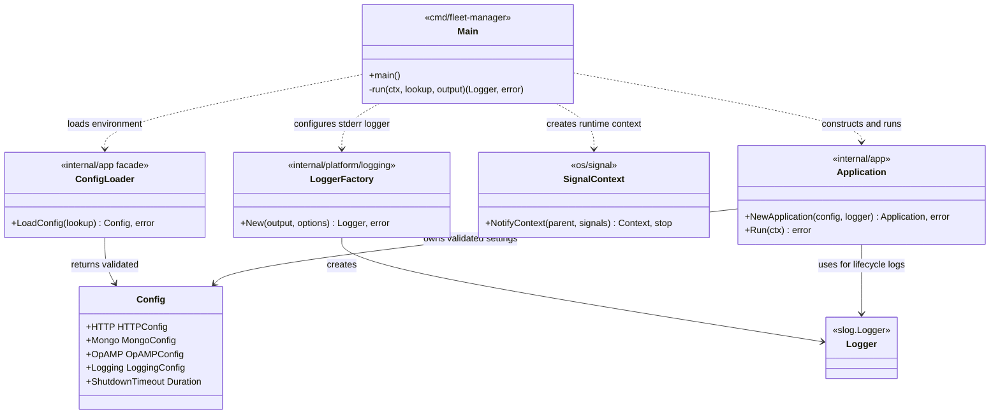

# Fleet Manager service entrypoint design

**Status:** Approved and implemented on the FM-01 application-wiring PR.

## Intent

Provide a runnable `fleet-manager` process that delegates service composition and resource lifecycle to the existing `internal/app.Application`. This closes the FM-01 command-entrypoint gap without moving business policy into startup code.

## Approaches

1. **Thin command package (recommended):** add `cmd/fleet-manager/main.go`. It loads validated configuration, creates the configured structured logger, builds `Application`, supplies a context canceled by OS termination signals, and reports a nonzero process exit on startup/runtime/shutdown errors. This uses current boundaries and leaves `internal/app` reusable.
2. **Process runner inside `internal/app`:** put signal handling and process exit behavior beside the application. This couples a reusable composition package to operating-system process policy and makes the boundary less clear, so it is not recommended.

The requested design uses approach 1.

## Class diagram

## Proposed behavior

- Load settings with `app.LoadConfig(os.LookupEnv)`; invalid settings stop startup before external resources are opened.
- Construct `slog.Logger` with `internal/platform/logging.New(os.Stderr, ...)` from validated logging settings; do not log or serialize the full config.
- Construct `app.NewApplication(cfg, logger)` and run it with `signal.NotifyContext` for interrupt and termination signals.
- Let `Application.Run` own startup, readiness, and bounded cleanup. A signal is a normal shutdown; a returned startup, runtime, or cleanup error produces a nonzero process exit.
- Keep `OPAMP_ENABLED=false` as the default. The command does not bypass authentication, TLS, or other application validation.

## Scope and constraints

- Add only the executable entrypoint and focused command-package tests; do not add business endpoints, new configuration, or a second lifecycle owner.
- Use the standard library for process signals and environment lookup; add no dependencies.
- Keep operational errors safe for stderr. Mongo driver error details are already redacted by the platform adapter; never print environment values or config structs.
- Update the runtime-configuration guide and FM-01 roadmap after implementation. FM-01 remains in progress until Mongo migrations and deployment-topology requirements are complete.

## Verification

- `go test ./cmd/fleet-manager` verifies argument-free configuration/bootstrap failure handling without opening external resources.
- `go test ./...`, `go test -race ./...`, `go vet ./...`, `golangci-lint run ./...`, and `go build ./...` verify package, repository, and executable behavior.
- Existing Application/Mongo/Supervisor integration remains the evidence for runtime lifecycle and OpAMP wiring; the command does not duplicate that integration harness.

## Implementation choice

The command uses the configured structured logger for errors after logger creation. If configuration or logger creation fails first, it uses `slog`'s standard stderr logger. Both paths emit returned sanitized errors only; environment values and config structs are never logged.
